# Jardinería · Suite de gestión

Aplicación de escritorio en **Java 21 + JavaFX** para gestionar la base de datos `jardineria` (MySQL 8 en Docker) con persistencia **JDBC pura** sobre un pool **HikariCP**. Incluye un CRUD completo de las 8 tablas, un panel general, analítica con filtro por año y un laboratorio interactivo de los **7 patrones estructurales GoF**, todo organizado en **arquitectura hexagonal** (puertos y adaptadores) cuyas fronteras se verifican con **ArchUnit**.

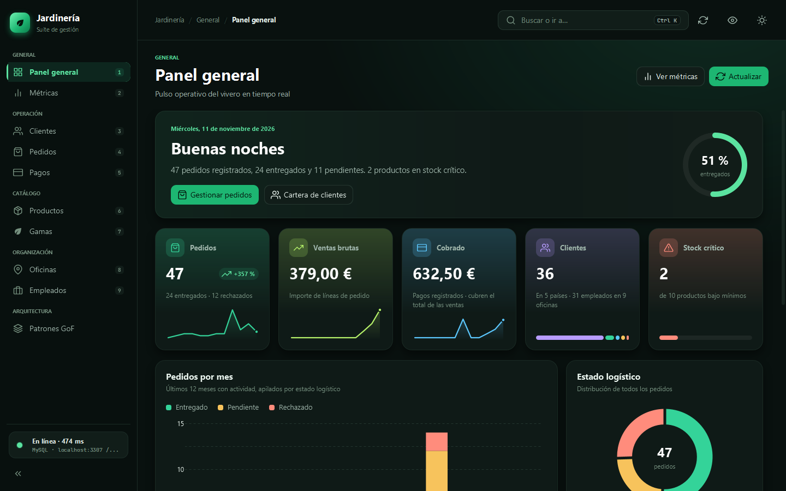

> Documentación técnica y visual completa en [`docs/`](docs/README.md): [instalación en cada sistema](docs/MULTIPLATAFORMA.md), [arquitectura](docs/ARQUITECTURA.md), [tecnologías](docs/TECNOLOGIAS.md), [panel general](docs/DASHBOARD.md), [apariencia y perfiles](docs/APARIENCIA.md), [asistente](docs/ASISTENTE.md), [mensajes](docs/MENSAJES.md) y [capturas](docs/CAPTURAS.md).

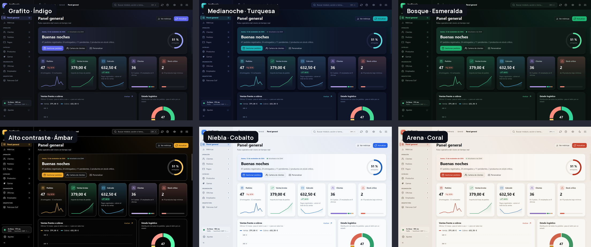

| Métricas | Ficha de cliente |
|---|---|
| 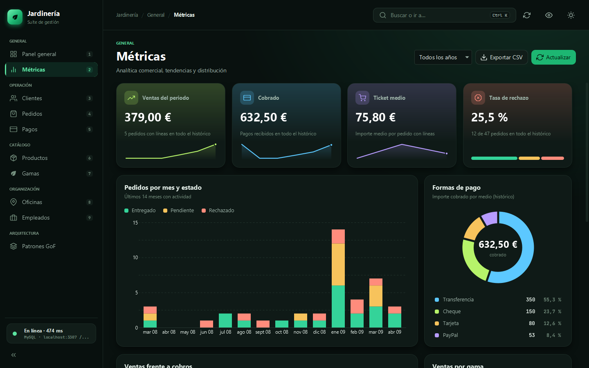 | 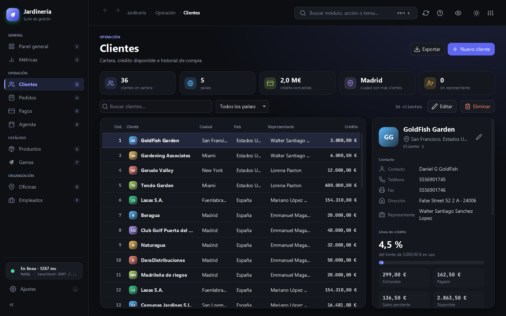 |
| **Agenda** | **Organigrama en la ficha de empleado** |
| 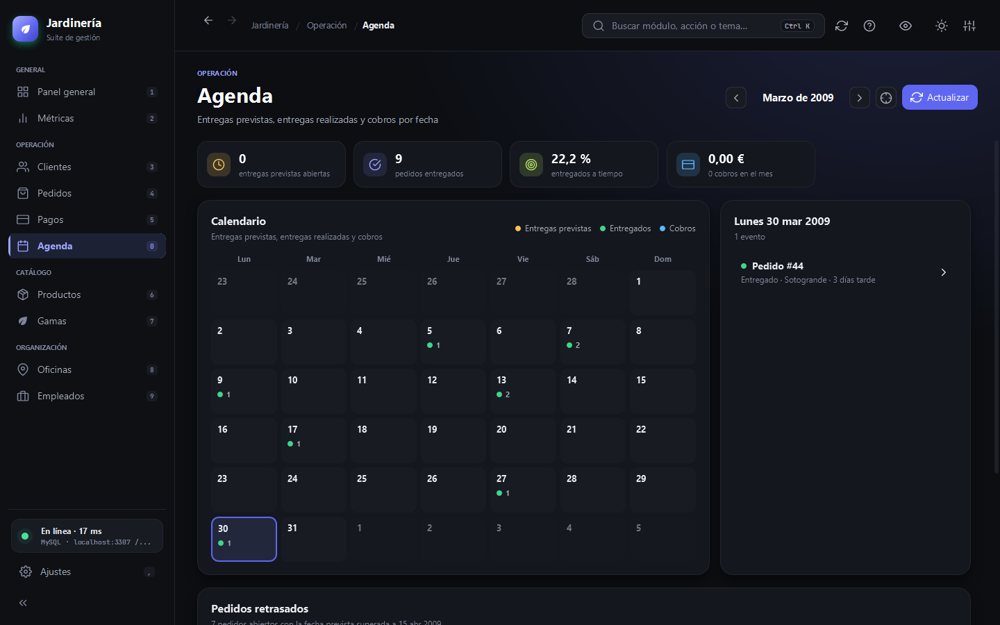 | 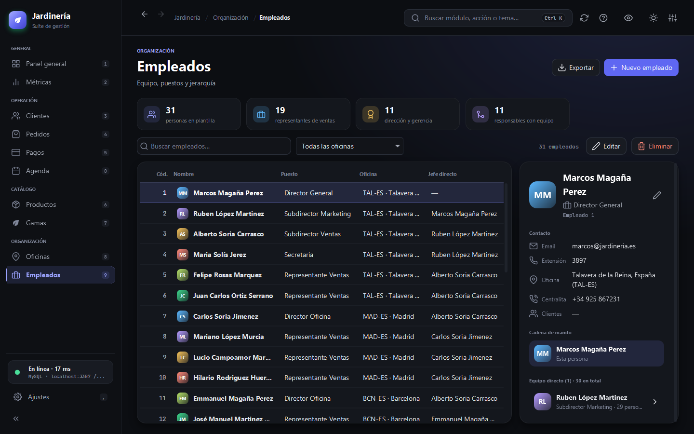 |
| **Tablero de pedidos** | **Asistente** |
| 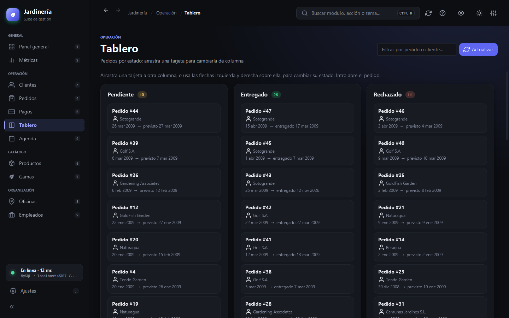 | 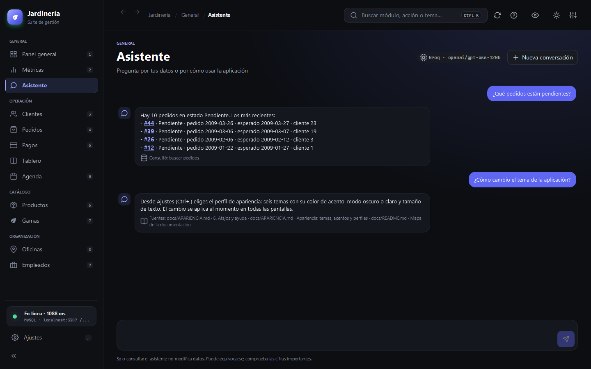 |
| **Mensajes del equipo** | |
| 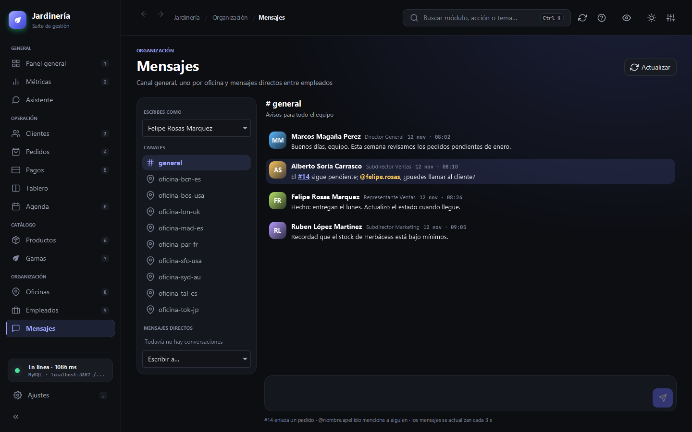 | |
| **Alta de pedido** | **Pedidos (tema claro)** |
| 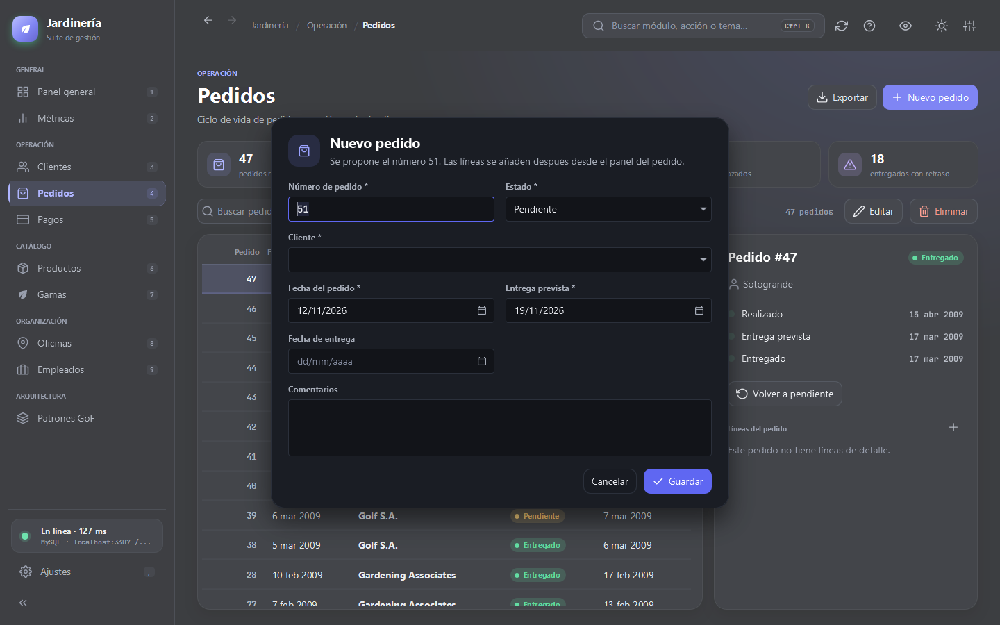 | 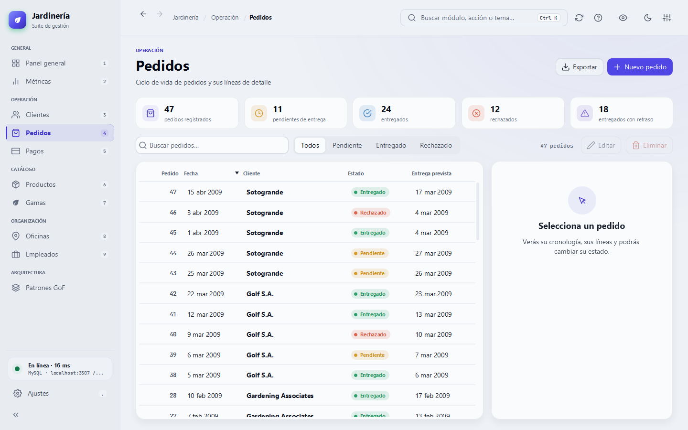 |

---

## Puesta en marcha

Funciona en **Windows, macOS (Intel y Apple Silicon) y Linux (x64 y ARM64)**. Solo necesitas **JDK 21** y **Docker**; Maven no hace falta, porque el proyecto incluye el *wrapper* (`mvnw`). Instalación por sistema y solución de problemas: [docs/MULTIPLATAFORMA.md](docs/MULTIPLATAFORMA.md).

| Sistema | Instalar requisitos |
|---|---|
| Windows | `winget install EclipseAdoptium.Temurin.21.JDK Docker.DockerDesktop` |
| macOS | `brew install --cask temurin@21 docker-desktop` |
| Ubuntu / Debian | `sudo apt install openjdk-21-jdk docker.io docker-compose-v2 libgtk-3-0` |

**Un solo comando** (comprueba requisitos, levanta MySQL, espera a que esté listo y abre la app):

| | macOS / Linux | Windows |
|---|---|---|
| Interfaz gráfica | `./scripts/iniciar.sh` | `scripts\iniciar.cmd` o `.\scripts\iniciar.ps1` |
| Consola | `./scripts/iniciar.sh --cli` | `scripts\iniciar.cmd cli` |
| Solo base de datos | `./scripts/iniciar.sh --db` | `scripts\iniciar.cmd db` |

**A mano:**

```bash
docker compose -f docker/docker-compose.yml up -d     # 1. MySQL + phpMyAdmin
./mvnw javafx:run                                     # 2. Interfaz gráfica (Windows: .\mvnw.cmd javafx:run)

# 3. (opcional) JAR ejecutable de tu plataforma: target/gestion-jardineria-2.0.0-<win|mac|mac-aarch64|linux|linux-aarch64>.jar
./mvnw package -DskipTests
java -jar target/gestion-jardineria-2.0.0-<plataforma>.jar          # interfaz gráfica
java -jar target/gestion-jardineria-2.0.0-<plataforma>.jar --cli    # consola interactiva
```

| Servicio | Dirección | Credenciales |
|---|---|---|
| MySQL 8.0 (`jardineria-mysql`) | `localhost:3307`, base `jardineria` | `root` / `password` |
| phpMyAdmin (`jardineria-phpmyadmin`) | <http://localhost:8090> | `root` / `password` |

La conexión se configura en `src/main/resources/application.properties` y se puede sobrescribir con las variables de entorno `DB_HOST`, `DB_PORT`, `DB_NAME`, `DB_USER` y `DB_PASSWORD`. Si MySQL no responde, la aplicación muestra una pantalla de "Sin conexión" con botón **Reintentar** en lugar de cerrarse.

### Volúmenes creados con versiones anteriores

El script de inicialización solo se ejecuta la primera vez que se crea el volumen. Si tus datos muestran caracteres rotos (`Fraçois`, `jardín`…), aplica la corrección sin perder datos:

```bash
docker exec -i jardineria-mysql mysql -uroot -ppassword --default-character-set=utf8mb4 jardineria < docker/maintenance/repair-encoding.sql
```

Si el volumen es anterior al módulo Mensajes, crea sus tablas (el script es idempotente; en PowerShell, `Get-Content docker/init/02-chat.sql -Encoding UTF8 | docker exec -i …`):

```bash
docker exec -i jardineria-mysql mysql -uroot -ppassword --default-character-set=utf8mb4 jardineria < docker/init/02-chat.sql
```

---

## Funcionalidad

| Módulo | Qué ofrece |
|---|---|
| **Pantalla de carga** | Al abrir la aplicación, un paisaje vectorial al amanecer (el sol sale, aparecen las colinas y brotan las plantas) acompaña a una barra que avanza con los pasos reales del arranque: tema, conexión con MySQL y preparación de los módulos. Con movimiento reducido el paisaje aparece estático. Se omite con `-Djardineria.splash=false`. Ver [docs/APARIENCIA.md](docs/APARIENCIA.md#7-pantalla-de-carga). |
| **Panel general** | Saludo con hora de actualización, 5 indicadores con variación trimestral honesta y sparklines interactivas, ventas frente a cobros (cursor y teclado), estado logístico, pedidos por mes, treemap de ventas por gama, mapa de calor de actividad con totales anuales, **lecturas clave** calculadas automáticamente, clientes más activos, stock crítico y actividad reciente. **Navegación contextual**: un clic en un estado, cliente, producto o pedido abre su módulo ya filtrado y con el elemento seleccionado. Ver [docs/DASHBOARD.md](docs/DASHBOARD.md). |
| **Métricas** | Filtro por año, ventas frente a cobros (gráfico de áreas con cursor), pedidos por mes y estado, ticket medio, tasa de rechazo, distribución por gama, país y forma de pago, ranking de clientes y exportación CSV. Las gamas, los países y los clientes llevan a su módulo filtrado. |
| **Asistente** | Preguntas en lenguaje natural sobre los datos (pedidos, clientes, stock, ventas) y sobre el uso de la aplicación, con las fuentes de la documentación citadas (RAG). Solo consulta; los pedidos que menciona abren su ficha. Usa Groq con la clave en la variable `GROQ_API_KEY`. Ver [docs/ASISTENTE.md](docs/ASISTENTE.md). |
| **Clientes** | Avatar con iniciales en cada fila, búsqueda sin tildes, filtro por país y ficha lateral con contacto, representante, crédito usado frente al límite y últimos pedidos y pagos. |
| **Pedidos** | Filtro por estado, cronología con aviso de retraso, cambio rápido de estado y gestión de líneas (el alta descuenta stock). |
| **Tablero** | Kanban de pedidos con una columna por estado. Se cambia el estado arrastrando la tarjeta o con las flechas izquierda y derecha, siempre con confirmación; `Intro` abre el pedido. Filtro por código o cliente. |
| **Agenda** | Calendario mensual de entregas previstas, entregas realizadas y cobros; cifras del mes (puntualidad e importe cobrado), detalle del día y pedidos retrasados. Se maneja con las flechas y cada pedido o cobro abre su módulo filtrado. Sin tablas nuevas. |
| **Empleados** | Avatar en cada fila y ficha lateral como **organigrama navegable**: cadena de mando hasta dirección, equipo directo, personas a cargo y clientes asignados. |
| **Pagos, Productos, Gamas, Oficinas, Empleados** | CRUD con validación inline (claves repetidas, importes y stock no negativos, fechas coherentes, cantidad de una línea ≤ stock disponible), filtros propios (forma de pago, gama, oficina, stock crítico) y resumen superior. |
| **Mensajes** | Chat interno con canal general, uno por oficina y mensajes directos. Se elige quién eres sin contraseña; `#14` enlaza el pedido, `@nombre.apellido` menciona y avisa, y cada canal muestra sus no leídos. Se actualiza cada 3 s contra MySQL, sin servidor adicional. Ver [docs/MENSAJES.md](docs/MENSAJES.md). |
| **Ajustes** | Perfiles de apariencia al estilo de la terminal de Ubuntu: 6 temas (4 oscuros, 2 claros), 7 acentos, tamaño de texto, densidad, esquinas, movimiento reducido, vista de inicio; exportar e importar perfiles. Ver [docs/APARIENCIA.md](docs/APARIENCIA.md). |

Todas las tablas permiten ordenar, buscar, copiar filas, exportar a CSV (UTF-8 con BOM y `;`, apto para Excel) y abrir el menú contextual. Las consultas se ejecutan en hilos virtuales, así que la interfaz nunca se congela; los errores de MySQL (clave duplicada, clave foránea, longitud) se traducen a mensajes comprensibles junto al campo afectado.

### Atajos de teclado

> En macOS, `Ctrl` es `⌘`, `Alt` es `⌥` y `Supr` es `⌫`; la aplicación muestra los símbolos de tu sistema.

| Atajo | Acción |
|---|---|
| `Ctrl+1` … `Ctrl+9`, `Ctrl+0` | Ir al módulo correspondiente (`Ctrl+0`: Agenda) |
| `Ctrl+K` | Paleta de comandos (navegar y acciones) |
| `Ctrl+N` / `Enter` / `Supr` | Nuevo / editar / eliminar el registro seleccionado |
| `Ctrl+F` | Enfocar el buscador del módulo |
| `F5` | Recargar datos |
| `Ctrl+T` | Alternar tema oscuro / claro |
| `Ctrl+B` | Contraer la barra lateral |
| `Ctrl+,` | Ajustes y perfiles de apariencia |
| `F1` / `Ctrl+/` | Chuleta de atajos de teclado |
| `Ctrl++` / `Ctrl+-` / `Ctrl+0` | Ampliar / reducir / restablecer el tamaño de letra |
| `Alt+←` / `Alt+→` | Vista anterior / siguiente |
| `Esc` | Cerrar el diálogo abierto |

Todos los botones de icono tienen texto accesible y tooltip, el foco es visible y la opción de reducir movimiento desactiva las animaciones.

---

## Arquitectura

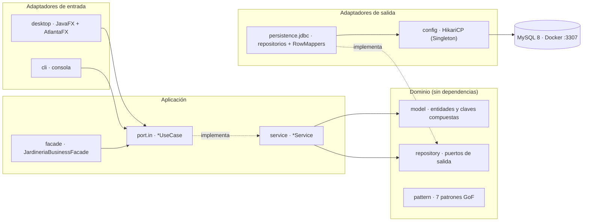

- **Dominio** (`com.jardineria.domain`): entidades con sus reglas de validación, excepciones de negocio, puertos de repositorio y patrones GoF. No importa JDBC, JavaFX ni nada de `application` o `infrastructure`.
- **Aplicación** (`com.jardineria.application`): un puerto de entrada `*UseCase` por agregado, implementado por su `*Service` (DIP), la analítica de lectura y la fachada de checkout.
- **Infraestructura** (`com.jardineria.infrastructure`): adaptadores JDBC con `PreparedStatement` y `RowMapper`, el pool HikariCP, la GUI JavaFX y la CLI. `ApplicationContext` es el *composition root*: construye el grafo de objetos sin efectos secundarios.
- `HexagonalArchitectureTest` (ArchUnit) hace fallar la build si alguna capa rompe estas fronteras.

```
src/main/java/com/jardineria
├── domain/            model · repository · exception · pattern/{adapter,bridge,composite,decorator,flyweight,proxy}
├── application/       port/in · service · facade · dto
└── infrastructure/
    ├── config/        ApplicationContext · DatabaseConfig · DatabaseConnectionManager
    ├── adapter/out/persistence/   jdbc · mapper
    └── adapter/in/
        ├── common/    Formatters (compartido por GUI y CLI)
        ├── cli/
        └── desktop/   shell · navigation · theme · support · components(/form) · views/{dashboard,analytics,agenda,board,crud,modules,settings}
```

### Patrones de diseño

Los siete patrones estructurales viven en el dominio y en la capa de aplicación, y se verifican con pruebas; la interfaz no tiene una pantalla de demostración, porque no aporta nada al trabajo diario.

| Patrón | Dónde | Cómo se comprueba |
|---|---|---|
| **Decorator** | `PriceCalculator` + descuentos e IVA | `GofStructuralPatternsTest`: el orden de las capas cambia el total |
| **Adapter** | `PaymentGatewayPort` ← PayPal / Stripe | `GofStructuralPatternsTest`: cada SDK produce el mismo `Pago` |
| **Composite** | `CatalogComponent` ← `ProductLeaf` / `ProductBundleComposite` | `GofStructuralPatternsTest`: precio y stock ensamblable recursivos |
| **Bridge** | `ExecutiveReport` × CSV / HTML / JSON | `GofStructuralPatternsTest`: mismo informe en tres formatos |
| **Flyweight** | `GamaFlyweightFactory` | `GofStructuralPatternsTest`; además lo usa la vista **Gamas** para el color de cada gama |
| **Proxy** | `CachedProductLookupProxy` | `GofStructuralPatternsTest`: aciertos y fallos de caché |
| **Facade** | `JardineriaBusinessFacade` | `JardineriaBusinessFacadeTest`: checkout que crea pedido, líneas y pago, o no crea nada si falla una regla |

En la GUI también se aplican **Template Method** (`BaseView`, `CrudModuleView`), **Command** (paleta `Ctrl+K`) y **Singleton** (`DatabaseConnectionManager`).

---

## Pruebas

```bash
./mvnw test                                    # suite completa (GUI en modo headless con Monocle)
./mvnw test -Dtest=DesktopScreenshotTest -Dui.screenshots=true   # capturas en target/screenshots
```

| Prueba | Cubre |
|---|---|
| `DomainEntitiesTest`, `GofStructuralPatternsTest`, `JardineriaBusinessFacadeTest` | Reglas del dominio y los 7 patrones |
| `ApplicationServicesTest`, `AnalyticsServiceTest` | Servicios con repositorios simulados (Mockito) |
| `JdbcRepositoriesIntegrationTest`, `AnalyticsJdbcRepositoryIntegrationTest` | SQL real contra el MySQL de Docker (se omiten si no está levantado) |
| `HexagonalArchitectureTest` | Fronteras entre capas (ArchUnit) |
| `DesktopSmokeTest` | La GUI completa sin base de datos: todas las rutas en ambos temas y los 7 formularios, sin errores |
| `NavigationRevealTest` | Navegación contextual: abrir Pedidos filtrado por código o por estado y con la fila correcta seleccionada |
| `OrgChartTest` | Ficha de empleado: cadena de mando, equipo directo y navegación entre personas con el teclado |
| `BoardViewTest` | Tablero: agrupación por estado, columnas vecinas y cambio de estado con teclado y confirmación |
| `AsistenteServiceTest`, `DocumentIndexTest`, `GroqLanguageModelAdapterTest`, `AsistenteViewTest` | Asistente: bucle de herramientas con un modelo guionizado, búsqueda BM25 en la documentación, protocolo de Groq contra un servidor HTTP local y la vista de conversación |
| `ChatModelTest`, `MensajeriaServiceTest`, `MensajeriaJdbcRepositoryIntegrationTest`, `ChatViewTest` | Mensajes: canales directos y menciones, reglas del servicio, SQL real de la mensajería y la vista con identidad, no leídos, envío y sondeo |
| `AgendaModelTest`, `AvatarTest` | Agenda (fecha de referencia, agrupación por día, retrasos, puntualidad) e iniciales y tonos de los avatares |
| `FormattersTest`, `SeriesTest`, `CsvExportTest` | Formato es-ES, series temporales y CSV RFC 4180 |
| `AppearanceProfileTest` | Perfiles de apariencia: límites, serialización tolerante y predefinidos |
| `DashboardInsightsTest`, `TreemapTest`, `ActivityHeatmapTest` | Lecturas clave, algoritmo squarified y niveles del mapa de calor |
| `DesktopScreenshotTest`, `DesktopGalleryTest` | Capturas de cada vista, tema, detalle, formulario, Ajustes y ventana mínima (opcional) |

---

## Flujo de trabajo Git

- Rama por defecto: `develop`. Cada cambio vive en una rama `feature/<nombre>` y se integra con `git merge --no-ff`.
- Commits convencionales con gitmoji: `✨ feat`, `🐛 fix`, `♻️ refactor`, `🎨 style`, `📝 docs`, `🧪 test`, `🔥 remove`, `🍱 assets`.
