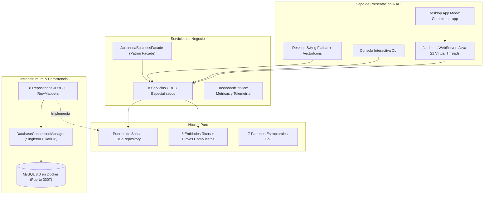

# Jardinería Enterprise Suite — Arquitectura Hexagonal & Command Center

Sistema empresarial de alto rendimiento en **Java 21 LTS** para la gestión analítica y operativa de la base de datos **Jardinería**, implementado bajo **Arquitectura Hexagonal (Ports & Adapters)**, principios **SOLID**, **Patrón Singleton** para la administración del pool de conexiones con **HikariCP**, **7 Patrones de Diseño Estructurales GoF** y una **Interfaz Gráfica Dual (Swing FlatLaf Desktop + Modo Aplicación de Escritorio Web standalone)**.

---

## 🏛️ Arquitectura Hexagonal y Principios de Diseño

El sistema respeta una separación estricta de responsabilidades sin dependencias de frameworks en el núcleo:



### Principios Fundamentales
- **Núcleo de Dominio (`domain`)**:
  - Entidades puras (`Oficina`, `Empleado`, `Cliente`, `GamaProducto`, `Producto`, `Pedido`, `DetallePedido`, `Pago`) y llaves compuestas (`DetallePedidoId`, `PagoId`).
  - Puertos de salida: Contratos de persistencia agnósticos (`CrudRepository<T, ID>` y contratos específicos).
  - Cero dependencias externas ni acoplamiento a librerías gráficas o de red.
- **Capa de Aplicación (`application`)**:
  - 8 Servicios orquestadores con validación de negocio, control de stock y verificación de crédito.
  - `DashboardService`: Agregación analítica en tiempo real de facturación, pedidos por estado y alertas de inventario.
- **Capa de Infraestructura (`infrastructure`)**:
  - **Patrón Singleton**: `DatabaseConnectionManager` thread-safe con pool HikariCP de alto rendimiento.
  - **Adaptadores Outbound**: Repositorios JDBC con `PreparedStatement` y `try-with-resources`.
  - **Adaptadores Inbound**:
    - **Swing Desktop**: Look & Feel FlatLaf, iconos vectoriales nativos `VectorIcons` (Java2D), microtendencias `SparklineChart`, alertas flotantes no bloqueantes `ToastNotificationManager`, migas de pan `BreadcrumbBar` y filtros reactivos `SearchFilterBar`.
    - **Desktop Web App Mode**: Servidor HTTP embebido en Java 21 (`HttpServer`) sirviendo una SPA reactiva con **Tailwind CSS**, **Chart.js**, iconos **Lucide SVG** y modo ventana independiente (`--app`).
    - **CLI**: Menú interactivo por terminal para entornos sin servidor gráfico.

---

## 🎨 Sistema de Diseño, Iconografía Vectorial y Componentes

### 1. Iconografía Vectorial Nativa (`VectorIcons`)
El sistema prescinde totalmente de emojis planos, utilizando un motor de dibujo vectorial matemático en Java2D (`Path2D` y `Graphics2D`). Los iconos se renderizan con suavizado anti-aliasing puro y se escalan de forma nítida en monitores de alta resolución (High-DPI / 4K).

### 2. Notificaciones Flotantes Toast (`ToastNotificationManager`)
Inspirado en los componentes de alerta dinámica de **JavaTMP** y Sonner, las notificaciones se presentan en la esquina inferior derecha de la ventana principal (`JLayeredPane`) con barra animada de progreso y cierre automático, eliminando cuadros de diálogo modales invasivos.

### 3. Microtendencias Sparkline (`SparklineChart`)
Cada tarjeta KPI integra un gráfico de microtendencia visual con curvas Bezier y gradiente descendente que ilustra la evolución reciente de facturación, pedidos y cartera de clientes.

### 4. Filtrado Avanzado tipo DataTables (`SearchFilterBar`)
Buscador reactivo con chips de estado (`[Todos]`, `[Entregados]`, `[Pendientes]`, `[Rechazados]`) y contador dinámico de registros en tiempo real.

---

## 🧩 Implementación de los 7 Patrones de Diseño Estructurales (GoF)

| # | Patrón | Metáfora Visual de Referencia | Clase Principal | Propósito en el Negocio |
| :-: | :--- | :--- | :--- | :--- |
| 1 | **Facade (Fachada)** | Mesero coordinando cocina, bar y caja | `JardineriaBusinessFacade` | Orquesta el checkout atómico: valida cliente, comprueba crédito, verifica stock, genera pedido y líneas, descuenta almacén y registra el cobro. |
| 2 | **Adapter (Adaptador)** | Clavija plana a toma de pared europea | `PayPalAdapter`, `StripeAdapter` | Traduce payloads de pasarelas de pago externas heterogéneas al modelo unificado `Pago`. |
| 3 | **Decorator (Decorador)** | Arepa base con queso, huevo y chorizo | `BulkDiscountDecorator`, `SeasonalPromoDecorator`, `VatTaxDecorator` | Calcula precios acumulando capas comerciales: base + volumen (-10%) + temporada primavera (-5%) + IVA (+21%). |
| 4 | **Composite (Compuesto)** | Caja de mudanza con cajas y objetos | `ProductBundleComposite`, `ProductLeaf` | Modela kits y lotes de jardinería que agrupan productos u otros sub-kits con cálculo recursivo de precio y stock. |
| 5 | **Proxy (Intermediario)** | Portero de seguridad y control de acceso | `CachedProductLookupProxy` | Intercepta búsquedas de productos en MySQL, ofreciendo caché en memoria RAM con métricas de hits/misses. |
| 6 | **Flyweight (Peso Ligero)** | Bosque compartiendo textura 3D | `GamaFlyweightFactory`, `GamaFlyweight` | Reutiliza estados intrínsecos botánicos y paletas en memoria compartida, desacoplado de AWT. |
| 7 | **Bridge (Puente)** | Control remoto y dispositivos TV/Radio | `ExecutiveReport`, `CsvOutputImplementor`, `HtmlOutputImplementor`, `JsonOutputImplementor` | Desacopla la abstracción de reportes de sus formatos de exportación en CSV, HTML moderno y JSON. |

---

## 🐳 Contenedor MySQL en Docker

El proyecto incluye su configuración oficial de Docker Compose mapeada al puerto `3307` del host:

```bash
docker compose -f docker/docker-compose.yml up -d
```

- **Host**: `localhost`
- **Puerto**: `3307` (mapeado al `3306` interno)
- **Base de Datos**: `jardineria`
- **Usuario**: `root`
- **Contraseña**: `jardineria_root_pwd`

---

## 🚀 Modos de Ejecución de la Aplicación

El proyecto se distribuye como un Uber JAR autónomo generado con Maven Shade:

```bash
# Compilar y empaquetar
mvn package -DskipTests=true
```

### 1. Modo Aplicación de Escritorio Web (Recomendado)
Abre la experiencia de interfaz web moderna (Tailwind CSS + Chart.js + Lucide) en una ventana independiente sin marco de navegador, simulando una app de Electron/Tauri:
```bash
java -jar target/gestion-jardineria-1.0.0.jar --app
```

### 2. Modo Interfaz Gráfica Nativa de Escritorio (FlatLaf Swing)
Ejecuta la interfaz nativa con temas Obsidian / Nordic, iconografía vectorial Java2D y barra de navegación:
```bash
java -jar target/gestion-jardineria-1.0.0.jar
```

### 3. Modo Consola Interactiva (CLI)
Para servidores remotos, terminales SSH o entornos sin servidor X11:
```bash
java -jar target/gestion-jardineria-1.0.0.jar --cli
```

---

## ⌨️ Atajos de Teclado Globales

| Atajo | Acción |
| :--- | :--- |
| `Ctrl + 1` | Panel General (Dashboard) |
| `Ctrl + 2` | Centro de Patrones GoF |
| `Ctrl + 3` | Oficinas Globales |
| `Ctrl + 4` | Equipo Laboral (Empleados) |
| `Ctrl + 5` | Cartera de Clientes |
| `Ctrl + 6` | Inventario y Stock de Productos |
| `Ctrl + 7` | Gestión de Pedidos |
| `Ctrl + 8` | Caja y Liquidaciones |
| `Ctrl + 9` | Gamas Botánicas |
| `Ctrl + T` | Alternar Tema Claro / Oscuro |
| `Ctrl + W` | Abrir Modo Aplicación de Escritorio Web |
| `F5` | Sincronizar y refrescar datos desde MySQL |

---

## 🧪 Pruebas Automatizadas

La suite cuenta con 23 pruebas automatizadas unitarias y de integración que cubren la API web, la persistencia JDBC, los servicios de aplicación, los 7 patrones GoF y el modelo de dominio:

```bash
mvn clean test
```

---

## 🤖 Guía para Agentes de Inteligencia Artificial

Para desarrolladores y agentes de IA (Claude, Antigravity, Cursor) que continúen trabajando en este repositorio, consultar el archivo [`AGENTS.md`](file:///home/camper/Documentos/gestion-db-jardineria/AGENTS.md) para detalles sobre estándares de codificación, arquitectura hexagonal, gestión de dependencias y flujo Git.
