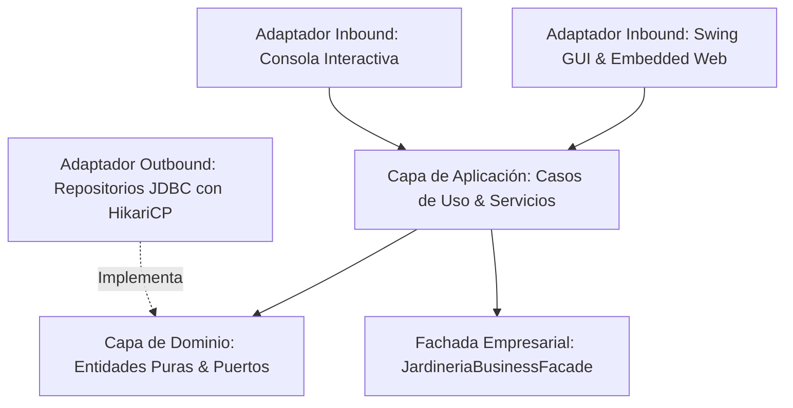

# 🌿 Sistema de Gestión de Base de Datos Jardinería — Enterprise Suite

Sistema integral en **Java 21 LTS** para la administración de la base de datos empresarial **Jardinería**, implementado bajo **Arquitectura Hexagonal (Ports & Adapters)**, principios **SOLID**, **Patrón Singleton** para la gestión del pool de conexiones con **HikariCP**, **7 Patrones de Diseño Estructurales GoF** y una **Interfaz Gráfica Dual (Swing FlatLaf Desktop + Modo Web/Electron)**.

---

## 🏛️ Arquitectura Hexagonal y Principios de Diseño

El sistema respeta una estricta separación de responsabilidades sin dependencias de frameworks en el núcleo:



- **Núcleo de Dominio (`domain`)**:
  - Entidades puras (`Oficina`, `Empleado`, `Cliente`, `GamaProducto`, `Producto`, `Pedido`, `DetallePedido`, `Pago`) y llaves compuestas (`DetallePedidoId`, `PagoId`).
  - Puertos de salida: Contratos de persistencia (`CrudRepository<T, ID>` y 8 interfaces de repositorio).
  - 100% independiente de cualquier framework o librería externa.
- **Capa de Aplicación (`application`)**:
  - 8 Servicios CRUD orquestadores con validación de negocio e integridad referencial.
  - `DashboardService`: Agregador de métricas en tiempo real y KPIs ejecutivos.
- **Capa de Infraestructura (`infrastructure`)**:
  - **Adaptadores Outbound**: Repositorios JDBC con `HikariCP`, RowMappers dedicados y `DatabaseConnectionManager` (Patrón Singleton thread-safe con shutdown hook).
  - **Adaptadores Inbound**:
    - **GUI Desktop**: Swing moderno con **FlatLaf** (Dark/Light mode, tarjetas KPI, renderizadores de píldoras SaaS, barra de distribución porcentual y exportación universal CSV).
    - **Modo Web / Electron**: Servidor HTTP embebido en Java 21 (`HttpServer`) sirviendo una SPA reactiva con **Tailwind CSS**, **Chart.js** y modo aplicación en Google Chrome (`--app`).
    - **CLI**: Menú interactivo por consola con submenús operacionales completos.

---

## 🧩 Implementación de los 7 Patrones de Diseño Estructurales (GoF)

Directamente inspirados en las infografías y metáforas visuales de referencia del proyecto:

| # | Patrón | Metáfora Visual de Referencia | Clase Principal | Propósito en el Negocio |
| :-: | :--- | :--- | :--- | :--- |
| 1 | **Facade (Fachada)** | Mesero coordinando cocina, bar y caja | `JardineriaBusinessFacade` | Orquesta el checkout transaccional completo: valida cliente, comprueba crédito, verifica stock, crea pedido y líneas, descuenta almacén y registra cobro. |
| 2 | **Adapter (Adaptador)** | Clavija plana a toma de pared europea | `PayPalAdapter`, `StripeAdapter` | Traduce payloads de pasarelas de pago externas heterogéneas al modelo unificado `Pago`. |
| 3 | **Decorator (Decorador)** | Arepa base con queso, huevo y chorizo | `BulkDiscountDecorator`, `SeasonalPromoDecorator`, `VatTaxDecorator` | Calcula precios acumulando capas comerciales: base + volumen (-10%) + temporada primavera (-5%) + IVA (+21%). |
| 4 | **Composite (Compuesto)** | Caja de mudanza con cajas y objetos | `ProductBundleComposite`, `ProductLeaf` | Modela kits y lotes de jardinería que agrupan productos u otros sub-kits con cálculo recursivo de precio y stock disponible. |
| 5 | **Proxy (Intermediario)** | Portero de seguridad y control de acceso | `CachedProductLookupProxy` | Intercepta búsquedas de productos en MySQL, ofreciendo caché en memoria RAM con métricas de hits/misses y auditoría. |
| 6 | **Flyweight (Peso Ligero)** | Bosque compartiendo textura 3D | `GamaFlyweightFactory`, `GamaFlyweight` | Reutiliza estados intrínsecos botánicos y paletas compartidas en memoria, desacoplado de librerías gráficas. |
| 7 | **Bridge (Puente)** | Control remoto y dispositivos TV/Radio | `ExecutiveReport`, `CsvOutputImplementor`, `HtmlOutputImplementor`, `JsonOutputImplementor` | Desacopla la abstracción de reportes de sus formatos de exportación en CSV, HTML moderno y JSON. |

---

## 🐳 Contenedor MySQL en Docker

El proyecto incluye su configuración Docker Compose oficial mapeada al puerto `3307` del host (para evitar colisiones con instancias locales en `3306`):

```bash
docker compose -f docker/docker-compose.yml up -d
```

---

## 🚀 Ejecución de la Aplicación

### 1. Interfaz Gráfica de Escritorio (GUI con FlatLaf)
```bash
java -jar target/gestion-jardineria-1.0.0.jar
```

### 2. Modo Web / Electron (SaaS Command Center)
Al abrir la GUI de escritorio, presiona el botón **`🚀 Modo Web / Electron`** en la cabecera, o accede directamente desde tu navegador a:
```
http://localhost:8081/dashboard
```

### 3. Modo Consola Interactiva (CLI)
```bash
java -jar target/gestion-jardineria-1.0.0.jar --cli
```

---

## 🧪 Pruebas Automatizadas

El proyecto cuenta con una suite completa de pruebas unitarias y de integración:

```bash
mvn test
```
