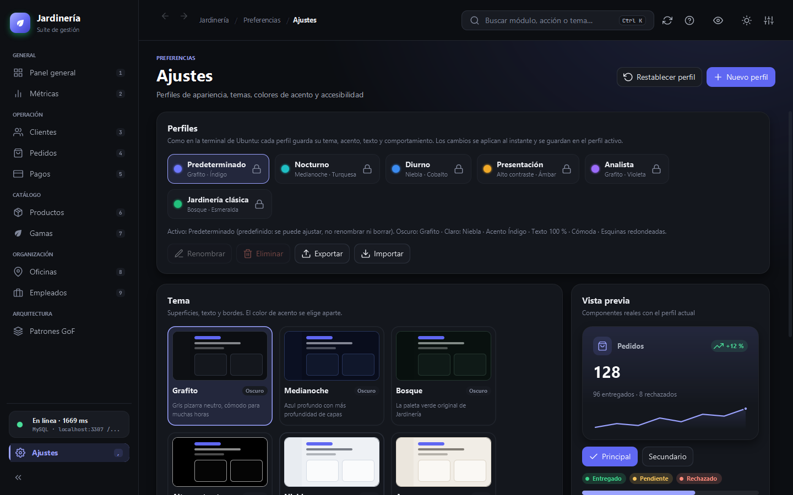
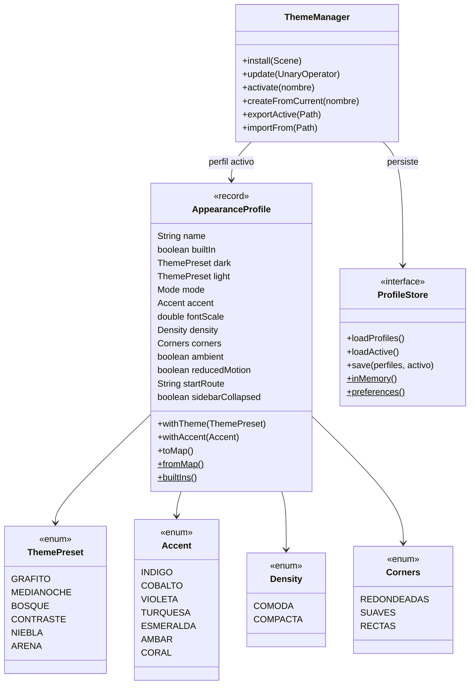
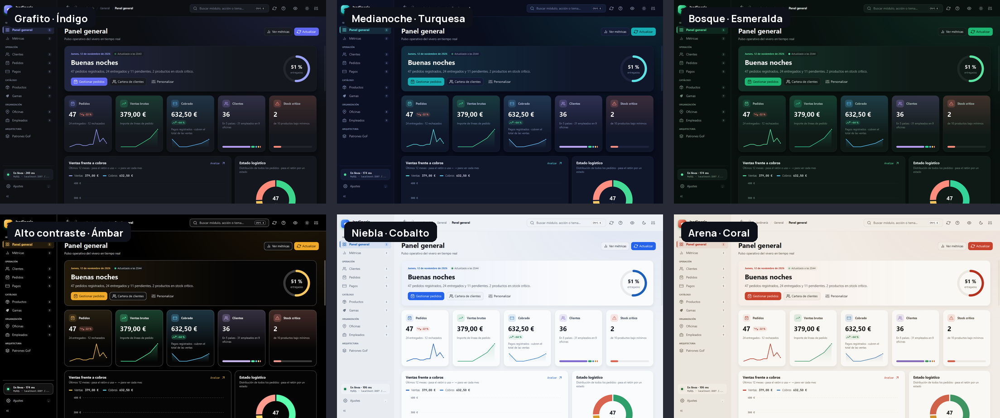
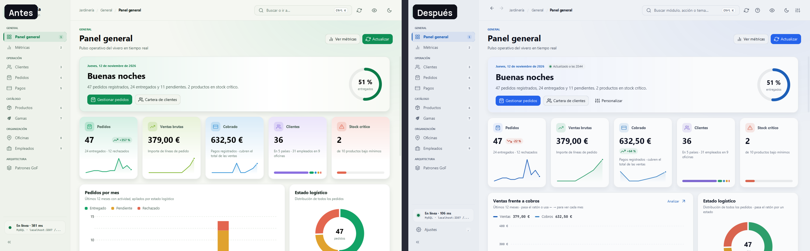
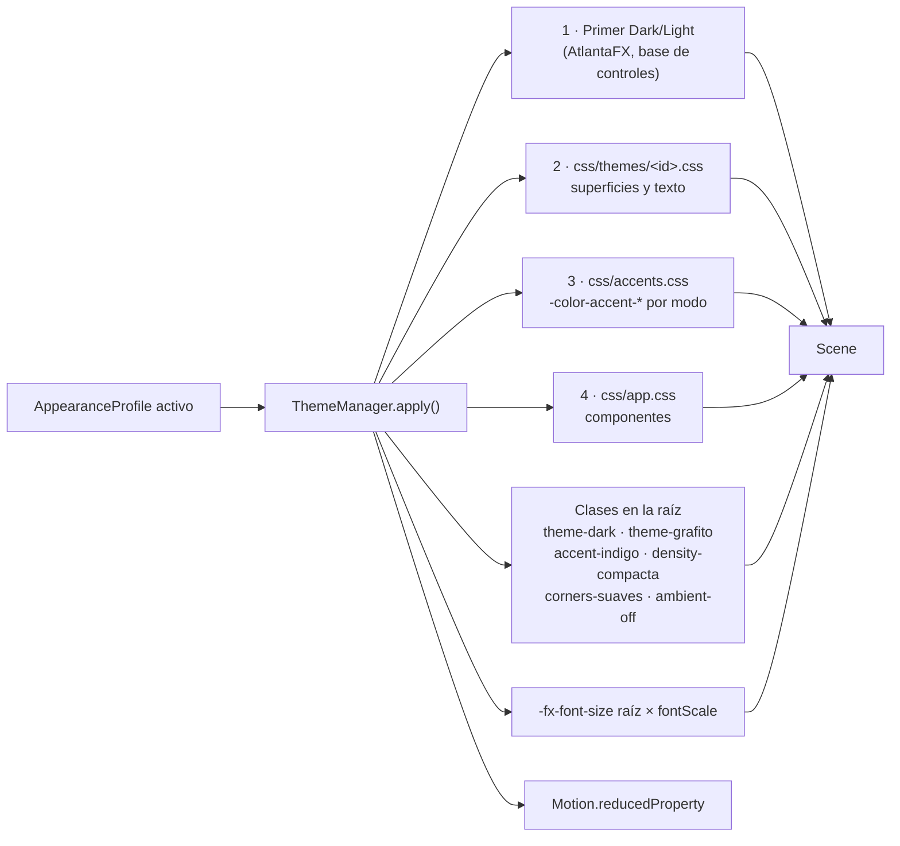
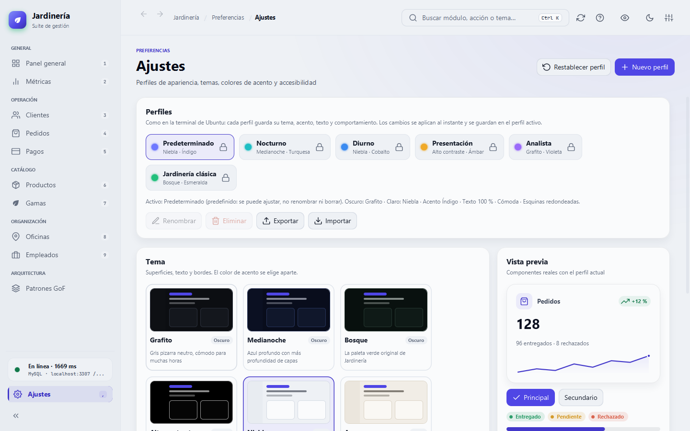
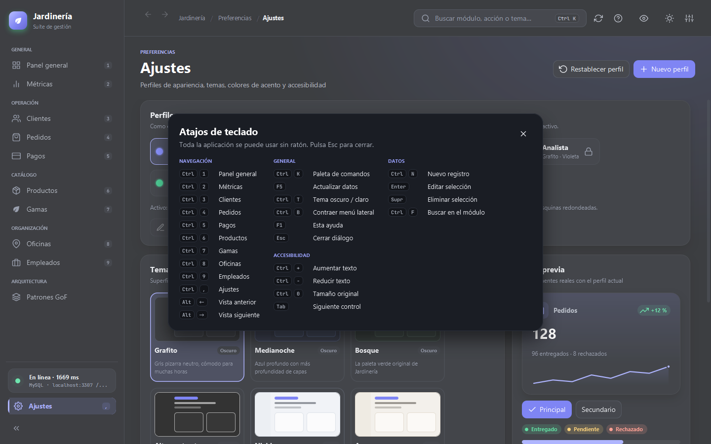
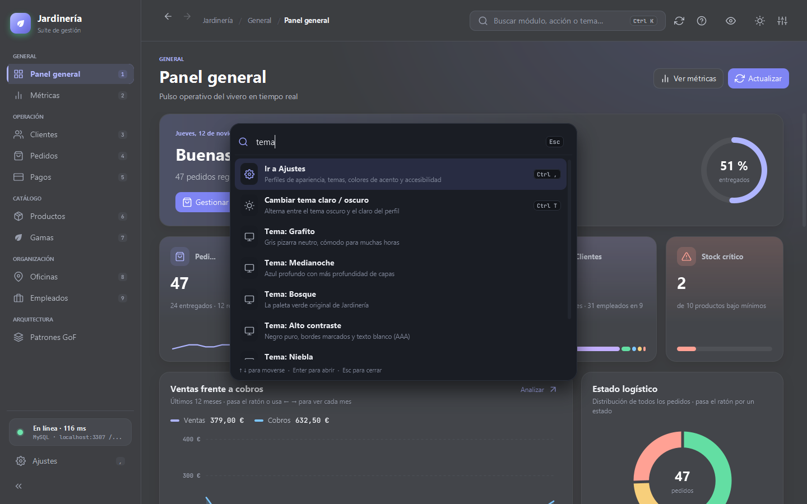
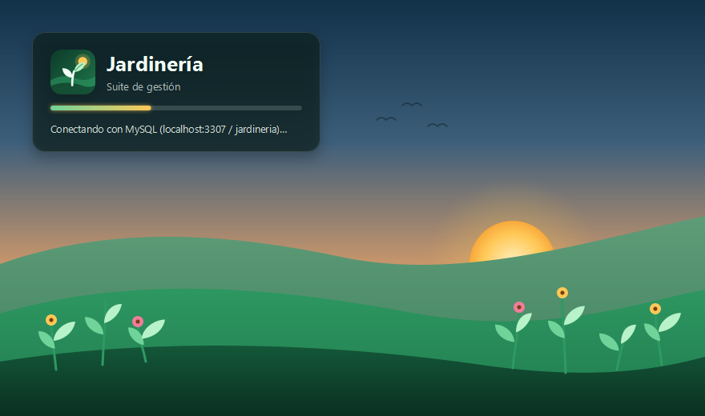

# Apariencia: temas, acentos y perfiles

La apariencia se configura **dentro de la aplicación**, en *Preferencias → Ajustes* (`Ctrl+,`), con un modelo inspirado en los perfiles de la terminal de Ubuntu: cada perfil guarda su combinación completa (tema oscuro, tema claro, acento, texto, densidad, esquinas y comportamiento) y se puede duplicar, renombrar, exportar e importar.

## 1. Modelo de datos

| Perfil predefinido | Oscuro / claro | Acento | Pensado para |
|---|---|---|---|
| Predeterminado | Grafito / Niebla (empieza en oscuro) | Índigo | Uso diario |
| Nocturno | Medianoche / Niebla (oscuro) | Turquesa | Poca luz |
| Diurno | Grafito / Niebla (empieza en claro) | Cobalto | Oficinas luminosas |
| Presentación | Alto contraste / Arena | Ámbar | Proyectores: texto al 120 %, sin animaciones, menú contraído |
| Analista | Grafito / Niebla | Violeta | Texto al 92 %, densidad compacta, abre en Métricas |
| Jardinería clásica | Bosque / Arena | Esmeralda | La identidad verde original |

Los predefinidos se pueden ajustar y restablecer, pero no renombrar ni borrar. Los perfiles propios se guardan con `java.util.prefs` (nodo `com/jardineria/desktop/appearance`) y se exportan a `.properties` para compartirlos.

## 2. Temas

- **Neutros por diseño.** Los temas solo definen superficies, texto, bordes y colores semánticos; el acento es independiente. Así el verde deja de ser omnipresente: queda reservado a «correcto / entregado».
- **Tema claro sin saturación.** Niebla y Arena usan fondos ligeramente tintados (no blanco puro), tarjetas KPI neutras sin degradados de color y sombras suaves.
- **Contraste verificado.** Cada archivo documenta la relación de contraste del texto principal, secundario y sutil sobre las tarjetas (p. ej. Grafito: 15,2:1 / 7,9:1 / 4,9:1, todos ≥ AA).

## 3. Canalización de estilos

El orden importa: cada capa sobrescribe a la anterior. Como el acento depende del modo, `accents.css` usa selectores compuestos (`.theme-dark.accent-indigo`, `.theme-light.accent-indigo`) para garantizar contraste en ambos.

## 4. Tokens de color

| Token | Uso |
|---|---|
| `-color-bg-*`, `-color-fg-*`, `-color-border-*` | Superficies, texto (default / muted / subtle / emphasis) y bordes |
| `-color-success-*`, `-color-warning-*`, `-color-danger-*` | Estados semánticos (entregado, pendiente, rechazado) |
| `-color-chart-1…8` | Series de gráficos, coherentes en todos los temas |
| `-color-accent-fg / -emphasis / -muted / -subtle` | Acento: texto, relleno, foco y fondo tenue |
| `-jd-canvas`, `-jd-card`, `-jd-track`, `-jd-shadow` | Lienzo, tarjetas, pistas de barras y sombras |
| `-jd-on-accent`, `-jd-glow`, `-jd-brand` | Texto sobre acento, resplandor ambiental y logotipo |
| `.tone-accent`, `.tone-jade`, `.tone-sky`, `.tone-lilac`, `.tone-coral`… | Tono de cada KPI (`-jd-tone`) |

**Regla:** ningún color fijo en Java. Los componentes vectoriales (gráficos, sparklines, mapa de calor) toman el color de CSS mediante clases de estilo, así responden al instante a cualquier cambio de tema o acento.

## 5. Accesibilidad y comodidad

| Ajuste | Efecto |
|---|---|
| Tamaño de texto (85 %–140 %) | Escala toda la interfaz; también `Ctrl++`, `Ctrl+-`, `Ctrl+0` |
| Densidad compacta | Reduce rellenos y alturas de fila |
| Esquinas | Redondeadas, suaves o rectas |
| Reducir movimiento | Desactiva contadores, revelados y transiciones (`Motion.isReduced()`) |
| Resplandor ambiental | Activa o quita el degradado de fondo |
| Alto contraste | Tema `CONTRASTE` desde el menú de accesibilidad de la barra superior |
| Vista de inicio y menú contraído | Por perfil |

## 6. Atajos y ayuda

`F1` o `Ctrl+/` abre la chuleta de atajos; `Ctrl+K` abre la paleta de comandos, que también permite cambiar de perfil, tema o acento escribiendo su nombre.

| Chuleta de atajos | Paleta de comandos |
|---|---|
|  |  |

## 7. Pantalla de carga

`shell.SplashScreen` se muestra en una ventana sin bordes de 880×520 mientras arranca la aplicación (`JardineriaDesktopApp.start`).

- **Paisaje**: cielo de amanecer en degradado, sol con resplandor, tres colinas en capas y siete plantas con flores, todo en vector (`SVGPath`). Las colinas suben de forma escalonada y las plantas crecen desde la base con un `Scale`. Los colores son fijos de la marca (`.splash-*` en `app.css`) y no dependen del tema.
- **Progreso real**: la barra avanza al completar cada paso (`SplashScreen.Paso`): aplicar el tema y las preferencias (hilo de JavaFX), comprobar MySQL con `ConnectionProbe` (hilo virtual) y crear el `AppShell` (hilo de JavaFX). Cada paso dura al menos 650 ms para que la animación se aprecie. Si un paso falla, se registra y la carga continúa: la aplicación ya muestra «Sin conexión» por su cuenta.
- **Movimiento reducido**: con `Motion.isReduced()` el paisaje aparece completo y la barra salta sin animación.
- **Desactivarla**: `-Djardineria.splash=false` abre directamente la ventana principal.
- **Pruebas**: `SplashScreenTest` comprueba el orden de los pasos, la tolerancia a errores y el 100 % final, y genera `target/screenshots/splash.png`.
