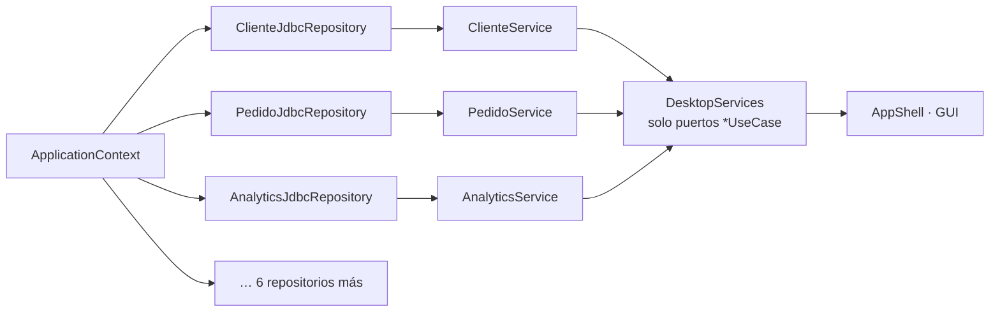
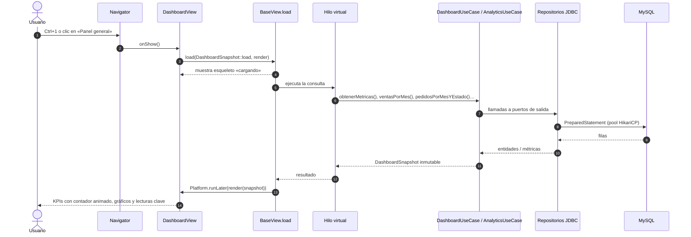
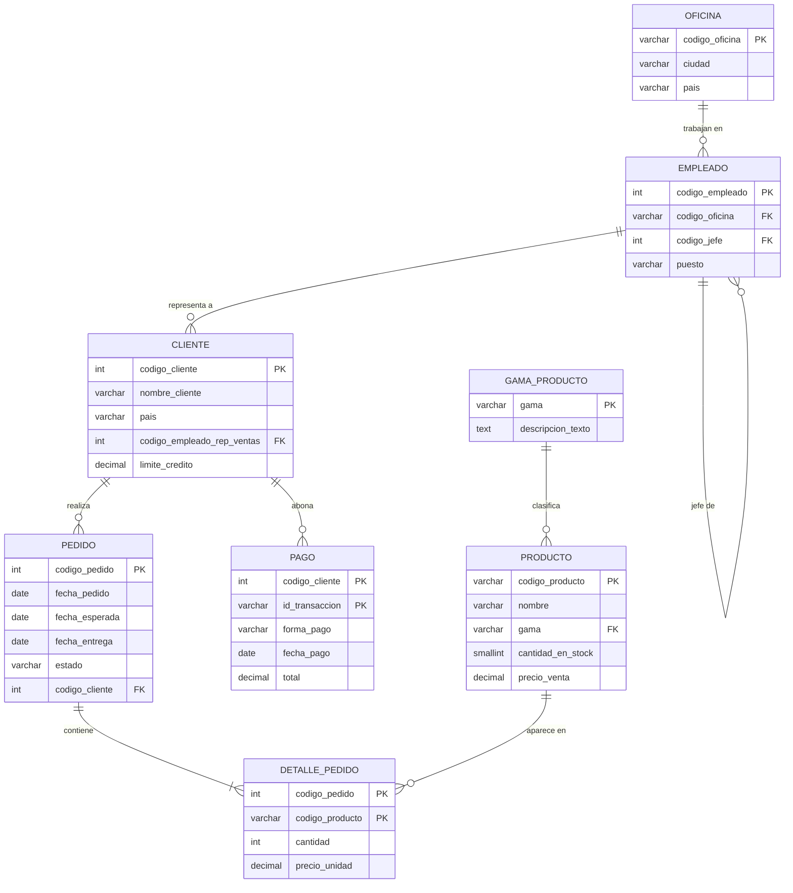
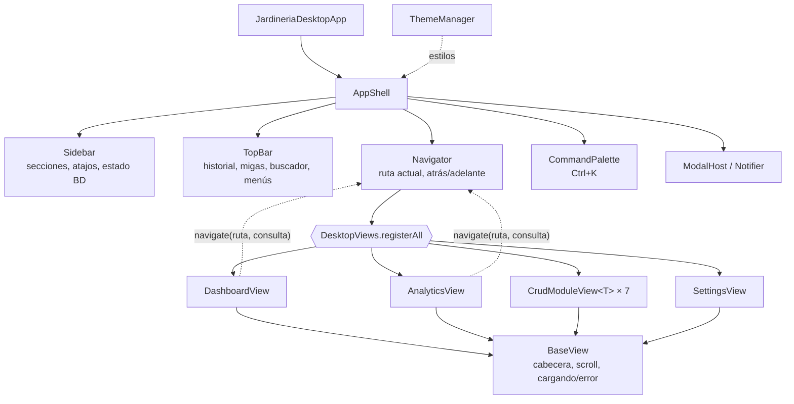

# Arquitectura

La aplicación sigue una **arquitectura hexagonal** (puertos y adaptadores). El dominio no conoce ni la base de datos ni la interfaz; ambas son detalles intercambiables que se conectan mediante interfaces. La regla se comprueba en cada build con **ArchUnit** (`HexagonalArchitectureTest`).

## 1. Capas y dependencias

```mermaid
flowchart TB
    subgraph IN["Adaptadores de entrada · infrastructure.adapter.in"]
        direction LR
        GUI["desktop<br/>JavaFX 21 + AtlantaFX"]
        CLI["cli<br/>consola interactiva"]
        COMMON["common<br/>Formatters es-ES"]
    end
    subgraph APP["Aplicación · application"]
        direction LR
        PIN["port.in<br/>11 × *UseCase"]
        POUT["port.out<br/>ModeloLenguaje · Documentacion"]
        SVC["service<br/>*Service"]
        FAC["facade<br/>JardineriaBusinessFacade"]
        DTO["dto<br/>DashboardMetrics…"]
    end
    subgraph DOM["Dominio · domain (solo JDK)"]
        direction LR
        MOD["model<br/>entidades + claves compuestas"]
        REPO["repository<br/>puertos de salida"]
        PAT["pattern<br/>7 patrones GoF"]
        EXC["exception"]
    end
    subgraph OUT["Adaptadores de salida · infrastructure.adapter.out"]
        direction LR
        JDBC["persistence.jdbc<br/>9 repositorios"]
        MAP["persistence.mapper<br/>RowMapper"]
        LLM["llm<br/>Groq (HTTP + JSON)"]
        DOCS["docs<br/>documentación del classpath"]
    end
    GROQ(["API de Groq"])
    CFG["config<br/>ApplicationContext · HikariCP"]
    DB[("MySQL 8<br/>Docker :3307")]

    GUI --> PIN
    CLI --> PIN
    GUI --> COMMON
    CLI --> COMMON
    SVC -. implementa .-> PIN
    FAC --> PIN
    SVC --> REPO
    SVC --> MOD
    JDBC -. implementa .-> REPO
    JDBC --> MAP
    JDBC --> CFG --> DB
    SVC --> POUT
    LLM -. implementa .-> POUT
    DOCS -. implementa .-> POUT
    LLM --> GROQ
```



| Capa | Puede depender de | Nunca de |
|---|---|---|
| `domain` | JDK | `application`, `infrastructure`, `java.sql`, `javafx` |
| `application` | `domain` | `infrastructure`, `java.sql`, `javafx` |
| `infrastructure` | todo | — |

**Inversión de dependencias (DIP):** los servicios dependen de `domain.repository.*Repository` (interfaces); las implementaciones JDBC viven fuera, en infraestructura. La GUI y la CLI solo ven los puertos `*UseCase`, agrupados para la GUI en el record `DesktopServices`.

Los puertos de salida que no son persistencia viven en `application.port.out`: `ModeloLenguajePort` (el modelo de lenguaje del asistente) y `DocumentacionPort` (la documentación que indexa el RAG). Ver [ASISTENTE.md](ASISTENTE.md).

## 2. Composición (composition root)

`ApplicationContext` es el único lugar donde se instancian clases concretas. Construye el grafo una vez, sin hilos ni efectos secundarios:



## 3. Recorrido de una petición: abrir el panel general

Las consultas JDBC **nunca** se ejecutan en el hilo de JavaFX. `BaseView.load(callable, render)` delega en `FxTasks.run`, que lanza la carga en un hilo virtual y vuelve al hilo de la interfaz solo para pintar.



Ventajas de la «fotografía» (`DashboardSnapshot`): una sola ida al servidor de datos, un único repintado (sin parpadeos) y un objeto inmutable fácil de probar.

## 4. Modelo de datos



- Claves compuestas modeladas con `DetallePedidoId` y `PagoId`.
- La gama `Herbaceas` es clave primaria y foránea: no se renombra en la base de datos; se muestra como «Herbáceas» con `Formatters.display`.

## 5. Interfaz de escritorio



- **Template Method**: `BaseView` y `CrudModuleView` fijan el esqueleto; cada módulo rellena `fetch`, `configureColumns`, `openEditor`…
- **Command**: la paleta de comandos ejecuta acciones con nombre (navegar, cambiar tema o perfil, exportar…).
- **Navegación contextual**: `Navigator.navigate(ruta, consulta)` abre la vista y llama a `View.reveal(consulta)`. Las vistas CRUD filtran por ese texto y seleccionan la mejor coincidencia (`#30` elige el pedido 30, no el 300); `PedidosView` traduce un estado («Pendiente») a su filtro segmentado.

## 6. Mapa de paquetes

```
src/main/java/com/jardineria
├── domain/            model · model/analytics · repository · exception · pattern/{adapter,bridge,composite,decorator,flyweight,proxy}
├── application/       port/in · port/out · service (+ rag) · facade · dto
└── infrastructure/
    ├── config/        ApplicationContext · DatabaseConfig · DatabaseConnectionManager
    ├── adapter/out/   persistence/{jdbc,mapper} · llm (Groq) · docs (RAG)
    └── adapter/in/
        ├── common/    Formatters (compartido por GUI y CLI)
        ├── cli/
        └── desktop/
            ├── views/assistant/  AsistenteView (conversación, enlaces #N)
            ├── shell/       AppShell · Sidebar · TopBar · CommandPalette · ShortcutsSheet
            ├── navigation/  Route · Navigator
            ├── theme/       ThemeManager · ThemePreset · Accent · AppearanceProfile · ProfileStore
            ├── support/     Motion · Icons · Interactions · Keys · Series · CsvExport · FxTasks · ModalHost · Notifier
            ├── components/  KpiCard · AreaTrendChart · ActivityHeatmap · Treemap · DonutChart · Sparkline · ResponsiveGrid · form/ …
            └── views/       dashboard · analytics · agenda · board · crud · modules · settings
```
