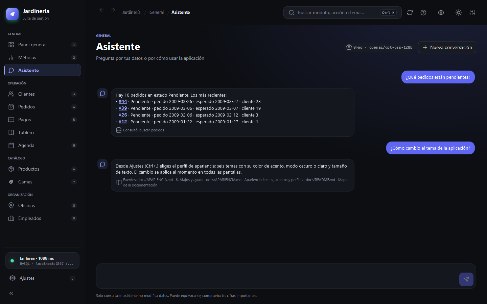
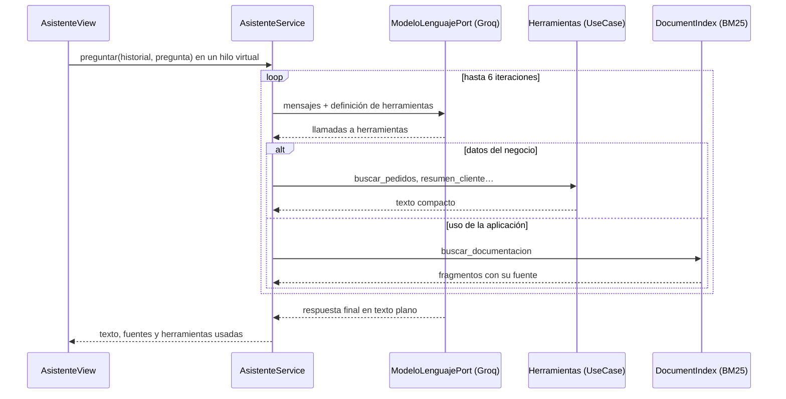

# Asistente

El módulo **Asistente** (menú General, o `Ctrl+K` y «Asistente») responde preguntas en lenguaje natural sobre dos cosas:

- **Los datos del negocio**: pedidos pendientes, ficha financiera de un cliente, stock bajo, mejores clientes, totales. Consulta los módulos **solo en modo lectura**: no hay ninguna herramienta que cree, cambie o borre datos.
- **El uso de la aplicación**: atajos, temas, instalación o arquitectura. Responde con fragmentos de esta documentación y cita las fuentes debajo de la respuesta (RAG).



Los pedidos que aparecen en una respuesta (`#14`) son enlaces que abren el módulo Pedidos con ese pedido seleccionado.

## Configuración

El asistente usa **Groq**, cuya API es compatible con la de OpenAI. La clave no se guarda nunca en el repositorio: se lee de variables de entorno al arrancar.

| Variable | Obligatoria | Por defecto | Para qué sirve |
|---|---|---|---|
| `GROQ_API_KEY` | Sí | — | Clave de [console.groq.com](https://console.groq.com/keys). Sin ella, la vista explica cómo configurarla. |
| `GROQ_MODEL` | No | `openai/gpt-oss-120b` | Modelo. También valen `openai/gpt-oss-20b`, `llama-3.3-70b-versatile` o `llama-3.1-8b-instant`. |
| `GROQ_BASE_URL` | No | `https://api.groq.com/openai/v1` | Otro servidor compatible con OpenAI. |

```powershell
# Windows (PowerShell): queda guardada para las próximas sesiones; abre una terminal nueva después
setx GROQ_API_KEY "gsk_..."
```

```bash
# macOS o Linux: añádelo a ~/.zshrc o ~/.bashrc para que se conserve
export GROQ_API_KEY="gsk_..."
./mvnw javafx:run
```

La clave nunca aparece en los registros. Los errores del proveedor se muestran en español: clave rechazada (401), modelo inexistente (404), conversación demasiado larga (413) y límite de uso alcanzado (429).

## Cómo funciona



1. La vista envía la pregunta y los últimos 12 turnos en un hilo virtual (`FxTasks`), así la interfaz no se congela.
2. `AsistenteService` manda al modelo un prompt de sistema en español con la fecha de hoy y la lista de herramientas.
3. Si el modelo pide herramientas, el servicio las ejecuta y le devuelve el resultado. Si una herramienta falla (por ejemplo, porque MySQL no responde), el error vuelve al modelo como texto para que lo explique. Tras 6 iteraciones el bucle se corta.
4. La respuesta final llega en texto plano. La vista convierte `#N` en enlaces y muestra las fuentes y las herramientas consultadas.

### Herramientas

| Herramienta | Consulta | Caso de uso |
|---|---|---|
| `buscar_documentacion` | Fragmentos de README, AGENTS y `docs/` | `DocumentIndex` |
| `metricas_generales` | Totales, pedidos por estado, ingresos, stock bajo | `DashboardUseCase` |
| `buscar_clientes` | Clientes por nombre, contacto, ciudad o país | `ClienteUseCase` |
| `resumen_cliente` | Comprado, pagado, saldo, uso del crédito y últimos pedidos | `AnalyticsUseCase`, `PedidoUseCase` |
| `buscar_pedidos` | Pedidos por estado o cliente, del más reciente al más antiguo | `PedidoUseCase` |
| `detalle_pedido` | Datos y líneas de un pedido con su total | `PedidoUseCase`, `DetallePedidoUseCase` |
| `buscar_productos` | Productos por nombre o gama, o con stock bajo | `ProductoUseCase` |
| `top_clientes` | Clientes con más compras por importe | `AnalyticsUseCase` |

Las herramientas devuelven como mucho 25 filas, con los importes en euros con formato es-ES. En los pedidos manda el estado: la fecha de entrega solo se muestra si el pedido está entregado.

### Recuperación de documentación (RAG)

Groq no ofrece embeddings, así que la recuperación es léxica y no depende de ningún servicio externo:

- **Corpus**: `README.md`, `AGENTS.md` y `docs/*.md`. Maven los copia al classpath en `rag/` (ver `<resources>` en el `pom.xml`), de modo que funcionan igual desde `target/classes` y desde el JAR. `ClasspathDocumentacionAdapter` los lee a partir de una lista fija.
- **Troceado**: por encabezados `#`, `##` y `###` (sin confundir los comentarios de los bloques de código) y, si una sección pasa de unos 1400 caracteres, por párrafos.
- **Normalización**: minúsculas, sin tildes (`java.text.Normalizer`), sin palabras vacías del español y con un recorte sencillo de plurales («temas» encuentra «tema»).
- **Puntuación**: BM25 (k1 = 1,4; b = 0,75). Se devuelven los 4 mejores fragmentos y la respuesta cita hasta 3 fuentes.

El índice se construye la primera vez que se usa y vive en memoria.

## Arquitectura

| Pieza | Capa | Paquete |
|---|---|---|
| `AsistenteUseCase` | Aplicación (puerto de entrada) | `application.port.in` |
| `ModeloLenguajePort`, `DocumentacionPort` | Aplicación (puertos de salida) | `application.port.out` |
| `AsistenteService`, `DocumentIndex` | Aplicación | `application.service`, `application.service.rag` |
| `GroqLanguageModelAdapter` | Infraestructura (`java.net.http` + Jackson) | `infrastructure.adapter.out.llm` |
| `ClasspathDocumentacionAdapter` | Infraestructura | `infrastructure.adapter.out.docs` |
| `AsistenteView` | Infraestructura (GUI) | `infrastructure.adapter.in.desktop.views.assistant` |

La capa de aplicación no conoce el JSON ni HTTP: trabaja con `Mensaje`, `Llamada`, `Herramienta` y `Respuesta`, y el adaptador los traduce al formato de OpenAI (`tools`, `tool_calls`, mensajes con rol `tool`). Cambiar de proveedor solo requiere otro adaptador.

## Pruebas

| Prueba | Cubre |
|---|---|
| `AsistenteServiceTest` | Bucle de herramientas con un modelo guionizado, fuentes del RAG, errores de herramienta, límite de iteraciones y estado sin clave |
| `DocumentIndexTest` | Troceado por secciones y búsqueda sin depender de tildes, mayúsculas ni plurales |
| `ClasspathDocumentacionAdapterTest` | La documentación real llega al classpath y el índice encuentra respuestas en ella |
| `GroqLanguageModelAdapterTest` | Formato de la petición y de la respuesta contra un servidor HTTP local, y mensajes de error sin exponer la clave |
| `AsistenteViewTest` | Sugerencias, enlaces a pedidos, fuentes, nueva conversación y navegación a Pedidos |

Ninguna prueba llama a Groq. Las capturas de esta página usan las herramientas y los datos reales de MySQL con un modelo de demostración guionizado (`DesktopScreenshotTest.ModeloDemo`).

## Límites

- El modelo puede equivocarse al resumir: la vista lo recuerda debajo del cuadro de texto.
- La conversación no se guarda: «Nueva conversación» o cerrar la aplicación la borra.
- Solo consulta. Para cambiar un pedido, el asistente explica cómo hacerlo desde Pedidos o el Tablero.
