# Capturas

Las imágenes de la documentación no se hacen a mano: las generan las pruebas de interfaz con **TestFX** sobre **Monocle** (JavaFX sin pantalla), contra la base de datos real de Docker. Así siempre reflejan la versión actual del código.

> ¿Por qué no Playwright? Playwright automatiza navegadores; esta aplicación es JavaFX de escritorio, así que el equivalente nativo es TestFX.

## Cómo regenerarlas

```bash
docker-compose -f docker/docker-compose.yml up -d          # MySQL con datos
./mvnw test -Dtest=DesktopScreenshotTest -Dui.screenshots=true  # cada módulo, ambos modos, formularios, ventana mínima
./mvnw test -Dtest=DesktopGalleryTest -Dui.screenshots=true     # temas, panel desplazado, Ajustes, atajos, paleta
```

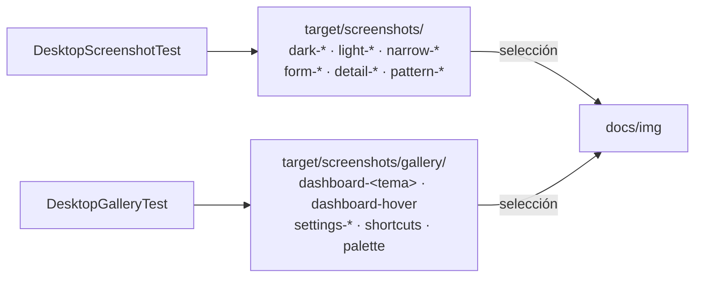

Si MySQL no está disponible, ambas clases se omiten (`assumeTrue`) en lugar de fallar.

## Galería

### Panel general

| Arriba | Cursor sobre la tendencia |
|---|---|
| 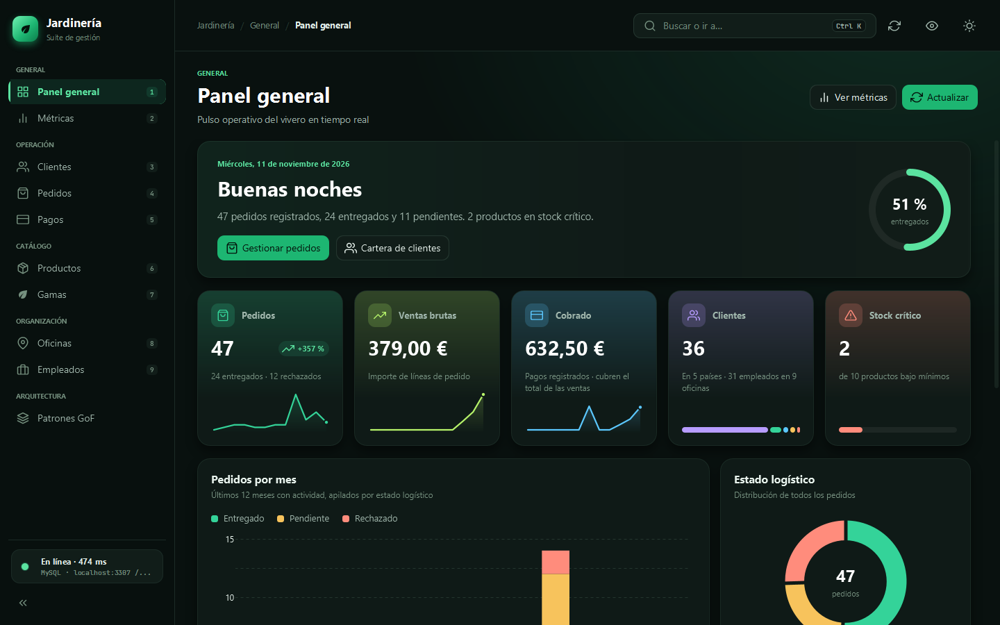 | 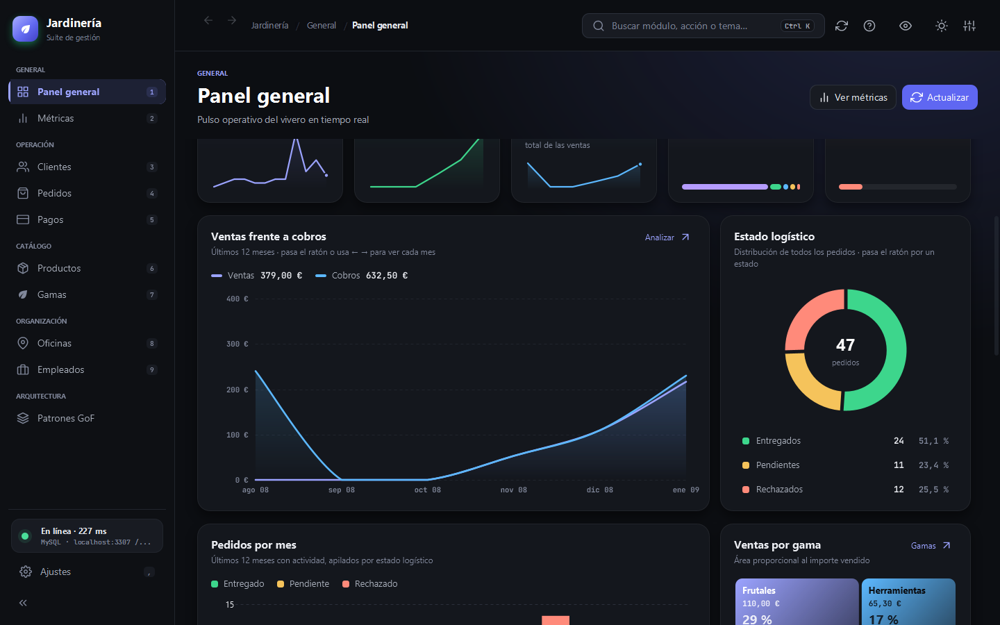 |
| **Mapa de actividad y lecturas** | **Listas** |
| 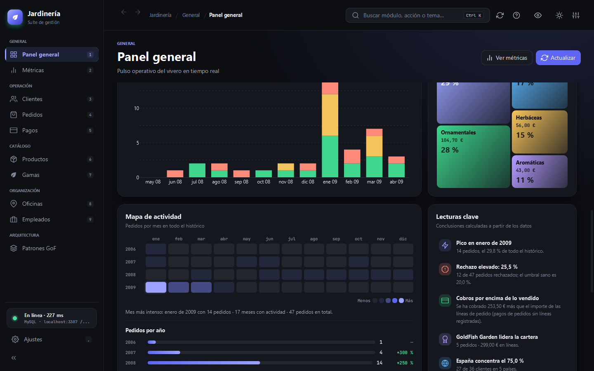 | 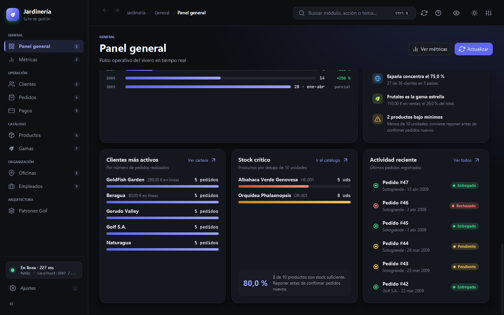 |

### Antes y después

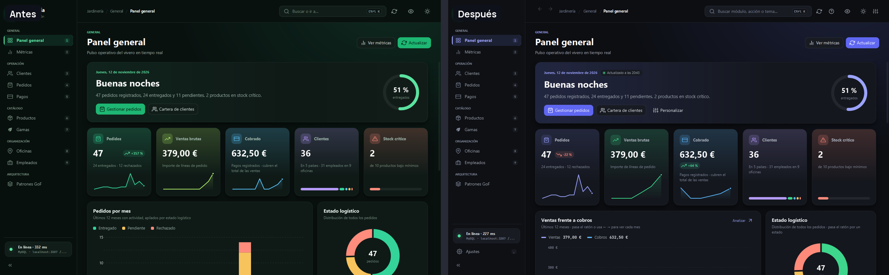

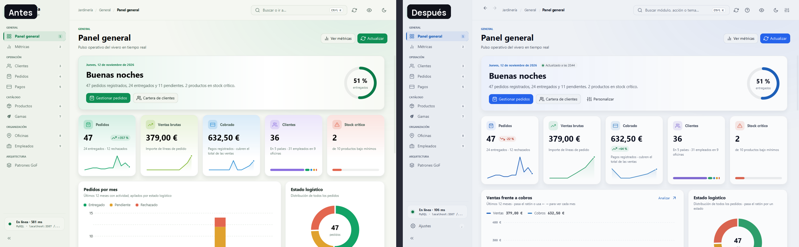

### Otros módulos

| Métricas | Pedidos (claro) |
|---|---|
| 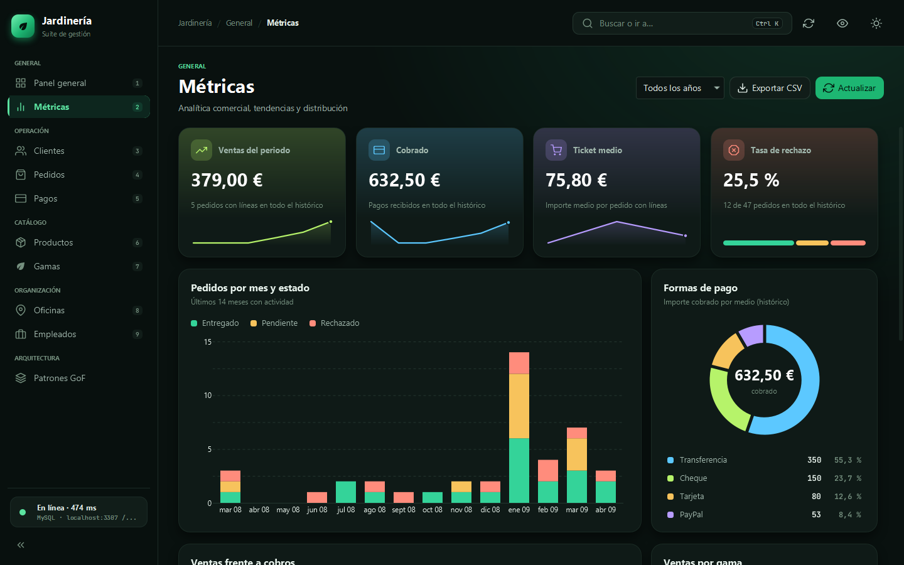 | 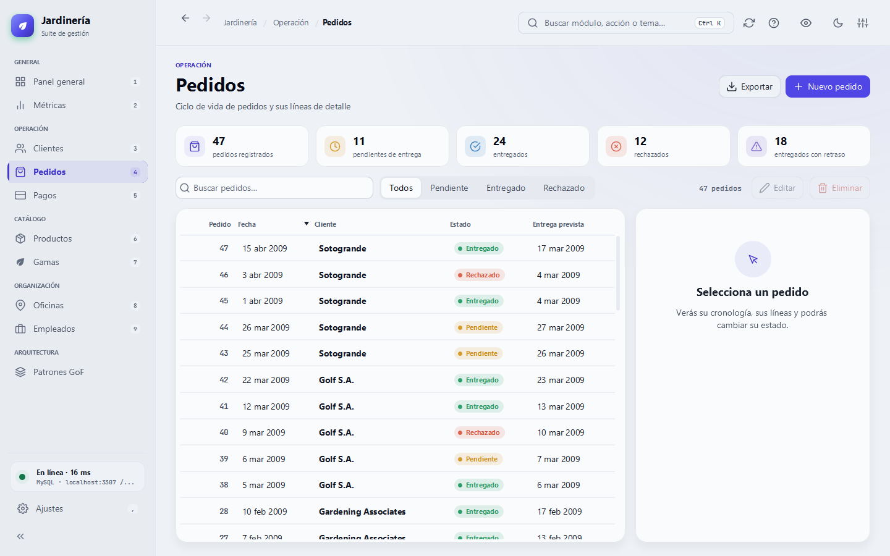 |
| **Ficha de cliente** | **Formulario de pedido** |
| 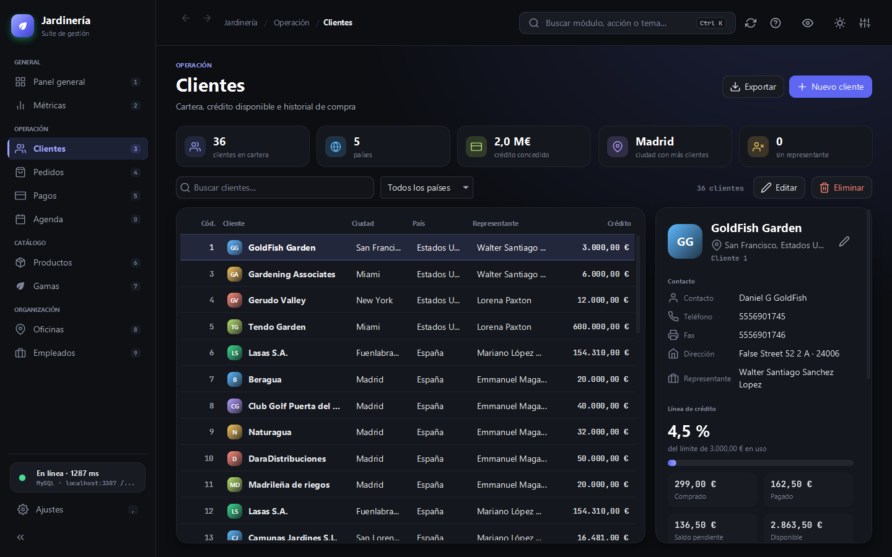 | 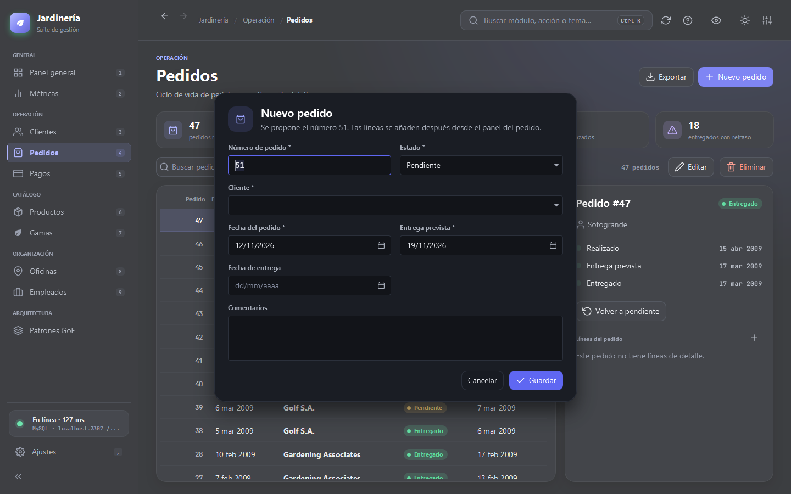 |
| **Patrón Decorator** | **Ajustes (parte inferior)** |
| 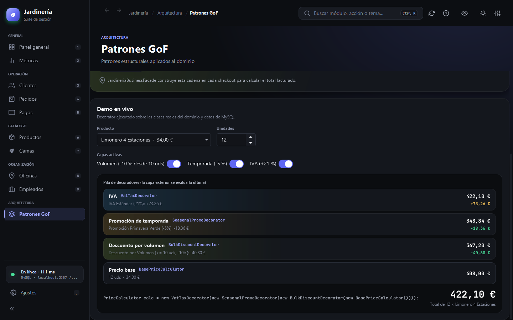 | 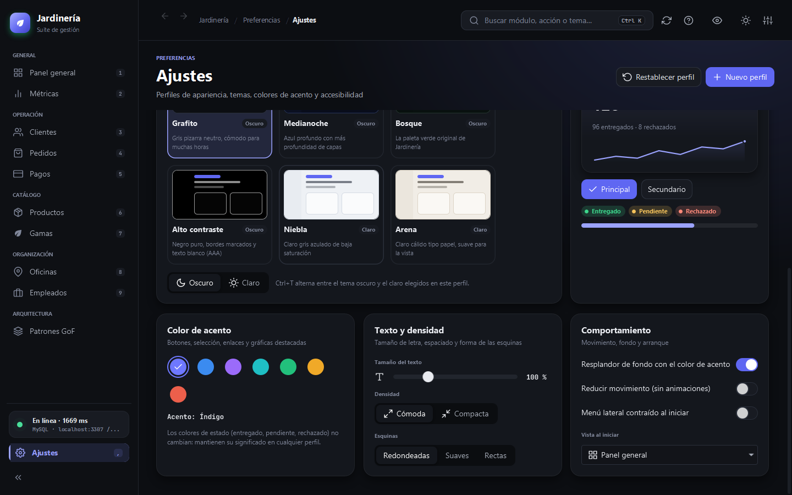 |
