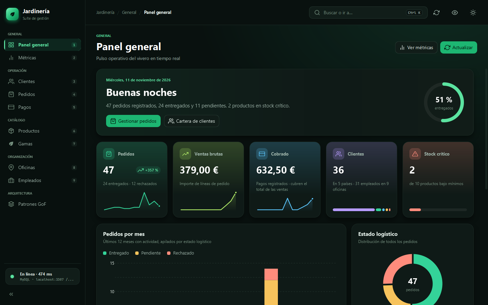
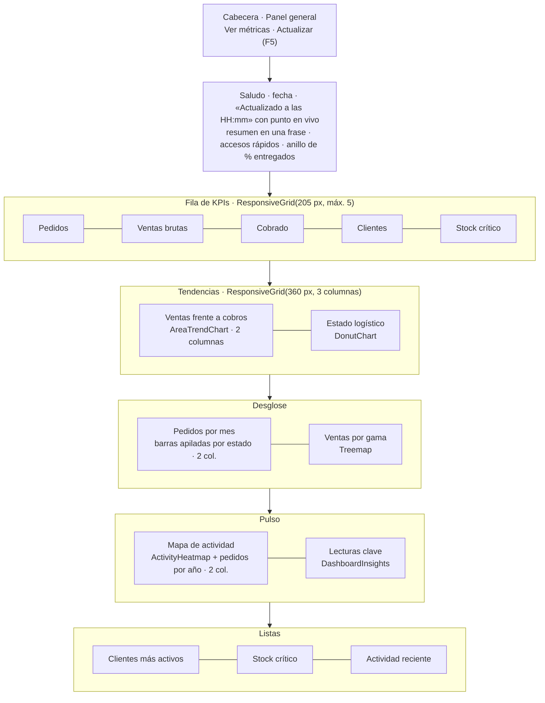
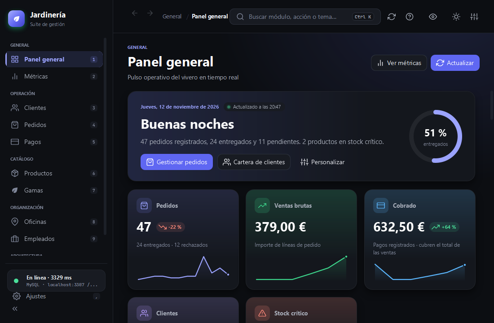
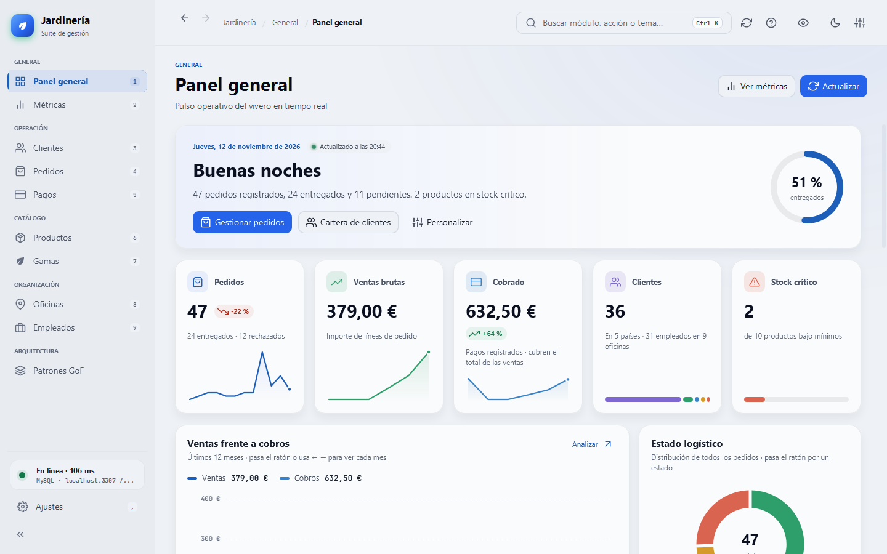
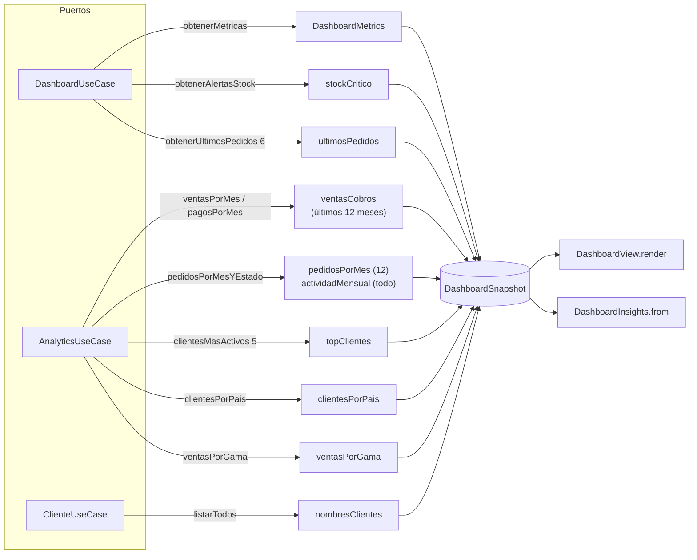
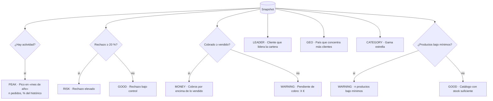
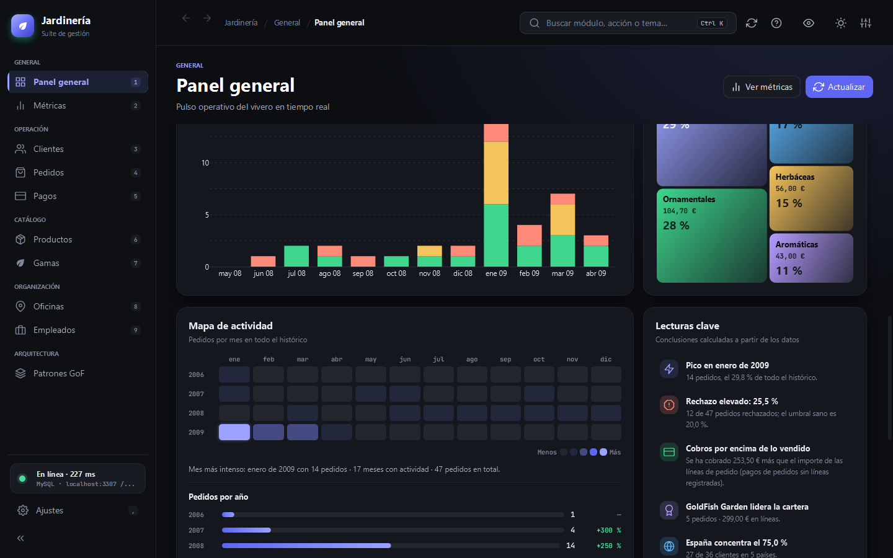
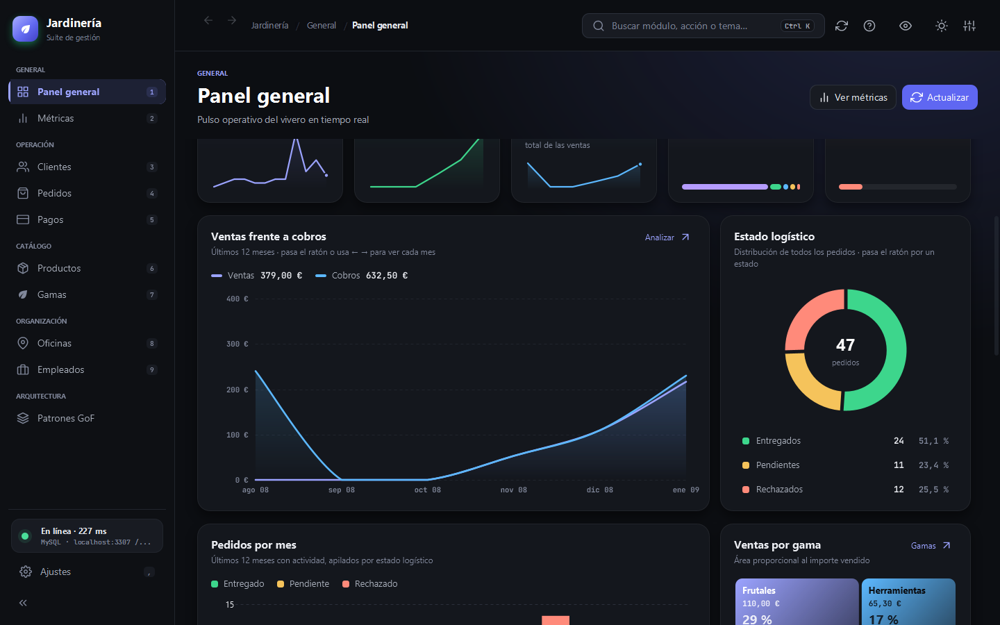
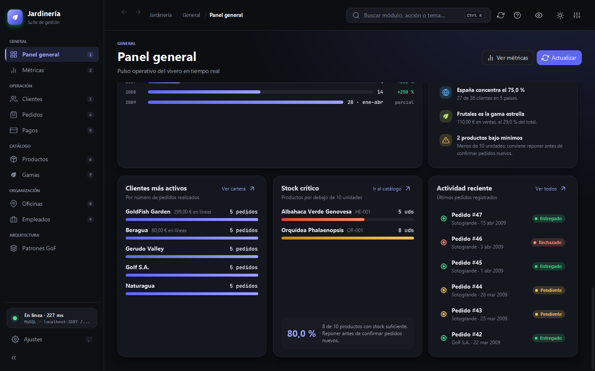

# Panel general

El panel general (`Ctrl+1`) resume el estado del vivero en una pantalla. Está pensado para responder en segundos tres preguntas: **¿cómo vamos?** (KPIs), **¿hacia dónde vamos?** (tendencias) y **¿qué requiere atención?** (lecturas clave, stock y actividad).

## 1. Estructura

Cada fila es un `ResponsiveGrid`: cuando la ventana se estrecha, los paneles **bajan de fila** en lugar de comprimirse (comprobado a 1100 × 720).

| Ventana mínima (1100 × 720) | Tema claro (Niebla · Cobalto) |
|---|---|
|  |  |

## 2. De dónde sale cada dato

Todo se obtiene en una sola tarea en segundo plano (`DashboardSnapshot.load`) a través de los puertos de entrada:

| Widget | Fuente | Cálculo |
|---|---|---|
| KPI **Pedidos** | `DashboardMetrics.totalPedidos` | Pie: entregados y rechazados. Sparkline: pedidos de los últimos 12 meses |
| KPI **Ventas brutas** | `ventasPorMes` | Suma de `cantidad × precio_unidad` de las líneas de pedido |
| KPI **Cobrado** | `DashboardMetrics.totalIngresos` | Suma de pagos; el pie indica si cubre las ventas |
| KPI **Clientes** | `totalClientes`, `clientesPorPais` | Barra segmentada por país |
| KPI **Stock crítico** | `obtenerAlertasStock` | Productos con menos de `UMBRAL_STOCK_CRITICO` (10) unidades |
| Ventas frente a cobros | `ventasCobros` | Dos áreas alineadas por mes (`Series.alignMonthly`) |
| Estado logístico | `DashboardMetrics` | Entregados / pendientes / rechazados con % |
| Pedidos por mes | `pedidosPorMes` | Barras apiladas de los 12 últimos meses con actividad |
| Ventas por gama | `ventasPorGama` | Treemap *squarified*: área ∝ importe |
| Mapa de actividad | `actividadMensual` | Cinco niveles de intensidad (`level = ⌈4 · n / máx⌉`) y totales anuales |

### Variación de los KPIs (chips)

El chip compara **los 3 últimos meses con los 3 anteriores** (`Series.recentChange(values, 3)`), y se oculta si el periodo base es cero. Antes se comparaba la primera mitad de la serie con la segunda, lo que producía cifras engañosas como «+357 %». Al pasar el ratón por el chip se explica qué se compara.

### Pedidos por año

El año en curso se marca como **parcial** (p. ej. «28 · ene–abr») en lugar de compararlo con años completos, porque esa variación sería engañosa.

## 3. Lecturas clave

`DashboardInsights` convierte los datos en frases cortas. Es lógica pura (sin JavaFX) y tiene pruebas propias (`DashboardInsightsTest`).

Cada tipo (`Kind`) decide el icono y el tono en la vista. Sin datos, no se inventa ninguna lectura.

## 4. Interacciones

| Elemento | Ratón | Teclado | Animación (si no hay movimiento reducido) |
|---|---|---|---|
| Tarjetas KPI | Se elevan; clic abre su módulo | `Tab` + `Enter` / `Espacio` | Contador ascendente de 0 al valor |
| Sparklines | Guía vertical y burbuja «mes · valor» | — | — |
| Ventas frente a cobros | Cursor con valores del mes y diferencia | `←` `→` recorren los meses | Revelado de izquierda a derecha |
| Donut logístico | Resalta segmento y fila de la leyenda; el centro muestra ese estado; clic abre Pedidos filtrado por ese estado | Filas de la leyenda: `Tab` + `Enter` / `Espacio` | — |
| Treemap de gamas | Ficha con gama, importe y porcentaje | — | Aparición progresiva de las teselas |
| Mapa de actividad | Ficha con «mes: n pedidos»; la celda crece | Celdas con pedidos enfocables | Aparición escalonada; barras anuales que crecen |
| Clientes más activos | Clic abre Clientes con ese cliente seleccionado | `Tab` + `Enter` / `Espacio` | Barras que crecen |
| Stock crítico | Clic abre Productos con ese producto seleccionado | `Tab` + `Enter` / `Espacio` | Barras que crecen |
| Actividad reciente | Clic abre Pedidos con ese pedido seleccionado | `Tab` + `Enter` / `Espacio` | — |

Estas filas usan `Interactions.activatable` (foco, rol de botón, clic, `Enter` y `Espacio`) y llegan al módulo con `Navigator.navigate(ruta, consulta)`, que rellena el buscador y selecciona la fila; el botón **Atrás** devuelve al panel. En **Métricas** funcionan igual las listas de gamas (→ Productos), países y clientes (→ Clientes).

## 5. Accesibilidad

- Cada KPI anuncia «título: valor. pie» al lector de pantalla y se comporta como botón.
- Las celdas del mapa de calor, filas anuales y lecturas tienen `accessibleText`.
- Los colores de estado nunca son la única señal: siempre van acompañados de texto (Entregado / Pendiente / Rechazado) o icono.
- Con *Reducir movimiento* todo se pinta en su estado final, sin transiciones.

## 6. Componentes reutilizables

| Componente | Paquete `desktop.components` | Notas |
|---|---|---|
| `KpiCard` | tarjeta | La cifra nunca se recorta: si no cabe junto al chip, el chip baja de línea |
| `AreaTrendChart` | gráfico | Curvas Catmull-Rom, rejilla con pasos «redondos» (`Series.niceStep`) |
| `ActivityHeatmap` | gráfico | Años × meses, 5 niveles del color de acento |
| `Treemap` | gráfico | `Treemap.squarify` es público y está probado (`TreemapTest`) |
| `DonutChart`, `Sparkline`, `BarList`, `StatStrip` | gráficos | Colores desde CSS (`-jd-tone`, `-color-chart-*`) |

