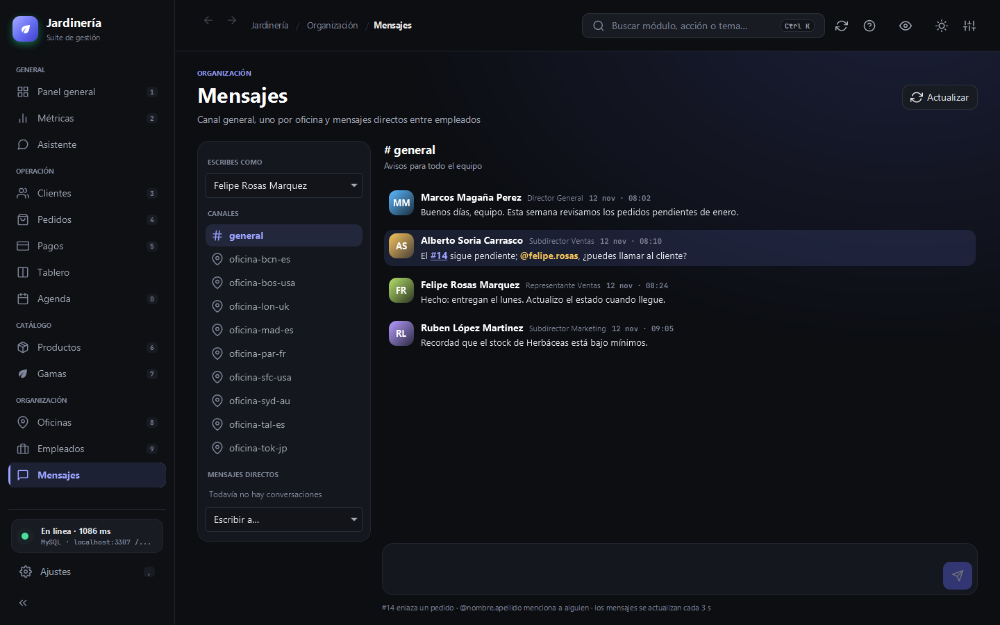
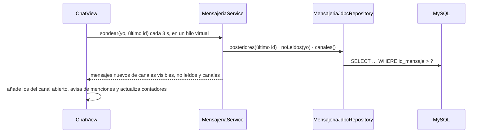
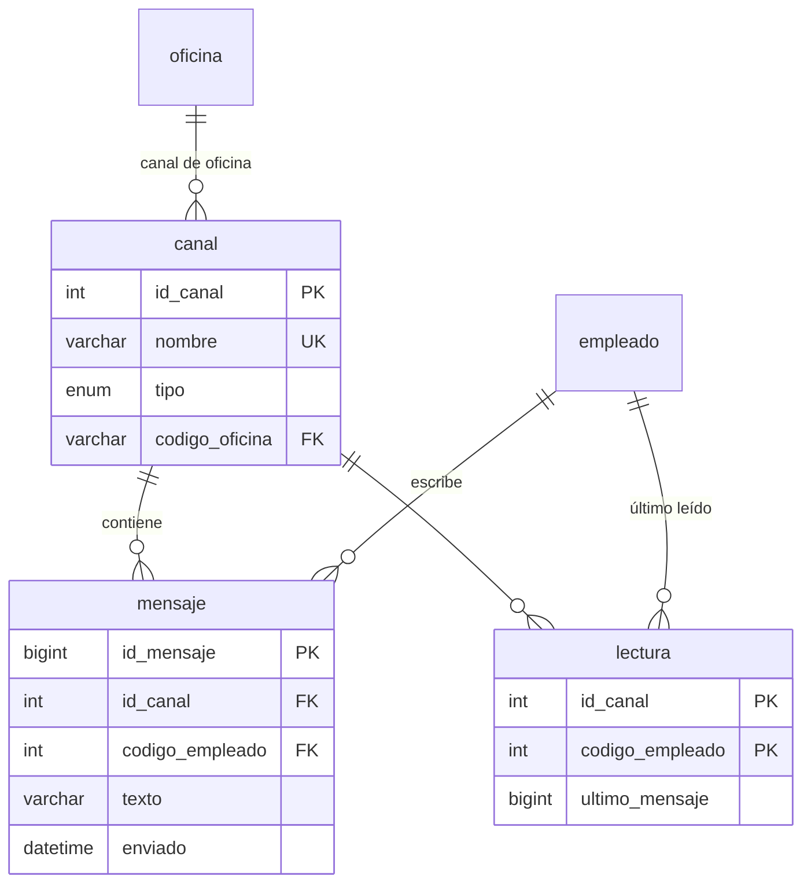

# Mensajes del equipo

El módulo **Mensajes** (menú Organización, o `Ctrl+K` y «Mensajes») es un chat interno con estilo de Slack sobre la misma base de datos MySQL. Tiene tres tipos de canal:

- **#general**, para todo el equipo;
- **un canal por oficina** (`oficina-tal-es`, `oficina-mad-es`…), creado a partir de la tabla `oficina`;
- **mensajes directos** entre dos empleados, que se crean al escribir el primero («Escribir a…»).



## Uso

- **Identidad sin contraseña**: en «Escribes como» se elige un empleado de la tabla. La aplicación lo recuerda en ese equipo (`java.util.prefs`) y solo muestra los canales que esa persona puede ver.
- **Escribir**: `Intro` envía y `Mayús+Intro` añade una línea. Un mensaje tiene como máximo 2000 caracteres.
- **Pedidos enlazados**: `#14` se convierte en un enlace que abre Pedidos con ese pedido seleccionado.
- **Menciones**: `@nombre.apellido` (primer nombre y primer apellido, sin tildes; por ejemplo `@felipe.rosas`) se resalta. Los mensajes que te mencionan aparecen destacados y, si llegan a otro canal, avisan con una notificación. Las direcciones de correo (`ventas@jardineria.es`) no cuentan como mención. El identificador de cada persona aparece en las listas de «Escribes como» y «Escribir a…».
- **No leídos**: cada canal muestra cuántos mensajes nuevos tiene. Al abrir el canal se marcan como leídos.

## Cómo funciona



- La consulta periódica solo se hace mientras la vista está en pantalla y nunca hay dos a la vez.
- No hace falta ningún servidor: todas las instancias de la aplicación conectadas al mismo MySQL ven los mismos mensajes. Con 3 segundos de intervalo y consultas por índice (`id_canal`, `id_mensaje`), la carga es mínima para un equipo de decenas de personas.
- Las fechas se guardan en UTC (el servidor y la conexión JDBC usan UTC) y se muestran en la hora local de cada equipo.

## Base de datos

Las tablas nuevas están en `docker/init/02-chat.sql` y no modifican las tablas originales de jardinería:



- Los canales directos se llaman `dm-<menor>-<mayor>` con los dos códigos de empleado. Así no hace falta una tabla de miembros y el nombre no depende del orden.
- `lectura` guarda hasta qué mensaje ha leído cada persona y nunca retrocede (`GREATEST`).
- El script es idempotente. En un volumen nuevo se ejecuta solo. En uno creado antes del chat, la vista explica cómo aplicarlo:

```bash
# macOS, Linux o Git Bash
docker exec -i jardineria-mysql mysql -uroot -ppassword --default-character-set=utf8mb4 jardineria < docker/init/02-chat.sql
```

```powershell
# Windows (PowerShell)
Get-Content docker/init/02-chat.sql -Encoding UTF8 | docker exec -i jardineria-mysql mysql -uroot -ppassword --default-character-set=utf8mb4 jardineria
```

## Arquitectura

| Pieza | Capa | Paquete |
|---|---|---|
| `Canal`, `Mensaje` (menciones e identificadores) | Dominio | `domain.model.chat` |
| `MensajeriaRepository` | Dominio (puerto de salida) | `domain.repository` |
| `MensajeriaUseCase`, `MensajeriaService` | Aplicación | `application.port.in`, `application.service` |
| `MensajeriaJdbcRepository` | Infraestructura | `infrastructure.adapter.out.persistence.jdbc` |
| `ChatView`, `ChatIdentity` | Infraestructura (GUI) | `infrastructure.adapter.in.desktop.views.chat` |

## Pruebas

| Prueba | Cubre |
|---|---|
| `ChatModelTest` | Nombre y visibilidad de los canales directos; menciones sin tildes ni puntuación y sin confundir correos; identificadores |
| `MensajeriaServiceTest` | Canales visibles y su orden, creación o reutilización de directos, validación al enviar y filtrado del sondeo |
| `MensajeriaJdbcRepositoryIntegrationTest` | SQL real: crear canal, publicar con tildes, orden, sondeo y no leídos que no retroceden (se omite sin MySQL o sin las tablas) |
| `ChatViewTest` | Identidad, contadores, menciones resaltadas, `#N`, envío, sondeo sin duplicados y mensaje directo |
