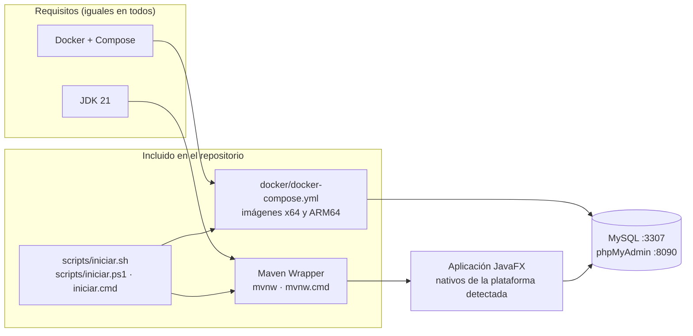

# Instalación y ejecución en cualquier sistema operativo

La aplicación funciona igual en **Windows**, **macOS** (Intel y Apple Silicon) y **Linux** (x64 y ARM64). Cada cambio se compila y se prueba en los cuatro sistemas con GitHub Actions (`.github/workflows/ci.yml`).



No hace falta instalar Maven: el *wrapper* (`mvnw` / `mvnw.cmd`) descarga la versión correcta (3.9.9) la primera vez.

## 1. Instalar los requisitos

| Sistema | Comando |
|---|---|
| **Windows 10/11** | `winget install EclipseAdoptium.Temurin.21.JDK Docker.DockerDesktop` |
| **macOS** (Homebrew) | `brew install --cask temurin@21 docker-desktop` |
| **Ubuntu / Debian** | `sudo apt install openjdk-21-jdk docker.io docker-compose-v2 libgtk-3-0` |
| **Fedora** | `sudo dnf install java-21-openjdk-devel moby-engine docker-compose gtk3` |
| **Arch / Manjaro** | `sudo pacman -S jdk21-openjdk docker docker-compose gtk3` |
| Cualquiera (alternativa) | [SDKMAN](https://sdkman.io): `sdk install java 21-tem` |

En **Linux**, además:

```bash
sudo systemctl enable --now docker       # arrancar Docker y dejarlo activo
sudo usermod -aG docker "$USER"          # usar docker sin sudo (cierra sesión y vuelve a entrar)
```

En **Windows** y **macOS**, abre Docker Desktop antes de continuar.

## 2. Ejecutar

### Con los scripts (recomendado)

Comprueban Java y Docker, levantan la base de datos, esperan a que MySQL esté listo y abren la aplicación.

| | macOS / Linux | Windows (PowerShell) | Windows (doble clic o cmd) |
|---|---|---|---|
| Interfaz gráfica | `./scripts/iniciar.sh` | `.\scripts\iniciar.ps1` | `scripts\iniciar.cmd` |
| Consola (CLI) | `./scripts/iniciar.sh --cli` | `.\scripts\iniciar.ps1 -Modo cli` | `scripts\iniciar.cmd cli` |
| Solo base de datos | `./scripts/iniciar.sh --db` | `.\scripts\iniciar.ps1 -Modo db` | `scripts\iniciar.cmd db` |
| Detener contenedores | `./scripts/iniciar.sh --parar` | `.\scripts\iniciar.ps1 -Modo parar` | `scripts\iniciar.cmd parar` |
| Comprobar requisitos | `./scripts/iniciar.sh --check` | `.\scripts\iniciar.ps1 -Modo check` | `scripts\iniciar.cmd check` |

`iniciar.cmd` llama a `iniciar.ps1` con `-ExecutionPolicy Bypass` solo para esa ejecución, así que no hay que cambiar la política de PowerShell del sistema.

### A mano

```bash
# macOS / Linux
docker compose -f docker/docker-compose.yml up -d     # o docker-compose, según la instalación
./mvnw javafx:run                                     # interfaz gráfica
./mvnw -q compile exec:java -Dexec.args=--cli         # consola
```

```powershell
# Windows
docker compose -f docker/docker-compose.yml up -d
.\mvnw.cmd javafx:run
.\mvnw.cmd -q compile exec:java "-Dexec.args=--cli"
```

## 3. JAR ejecutable por plataforma

JavaFX necesita librerías nativas distintas para cada sistema. El JAR se genera para la plataforma donde se compila y su nombre la indica:

```bash
./mvnw package -DskipTests        # → target/gestion-jardineria-2.0.0-<plataforma>.jar
java -jar target/gestion-jardineria-2.0.0-<plataforma>.jar          # interfaz gráfica
java -jar target/gestion-jardineria-2.0.0-<plataforma>.jar --cli    # consola
```

| Plataforma | Sufijo | Detectada cuando… |
|---|---|---|
| Windows x64 | `win` | Windows |
| macOS Intel | `mac` | macOS + x86_64 |
| macOS Apple Silicon (M1–M4) | `mac-aarch64` | macOS + aarch64 |
| Linux x64 | `linux` | Linux + amd64 |
| Linux ARM64 (Raspberry Pi 4/5…) | `linux-aarch64` | Linux + aarch64 |

Para generar el JAR de **otra** plataforma desde tu equipo:

```bash
./mvnw package -DskipTests -Djavafx.platform=mac-aarch64
```

> No existe un único JAR para todas: los nativos de Intel y de ARM tienen el mismo nombre de archivo y se pisarían. La CI publica un JAR por plataforma como artefacto descargable.

## 4. Diferencias entre sistemas

| Aspecto | Windows | macOS | Linux |
|---|---|---|---|
| Tecla de atajos | `Ctrl` | `⌘` (los textos de la app lo muestran así) | `Ctrl` |
| Atrás / adelante | `Alt+←` / `Alt+→` | `⌘[` / `⌘]` y también `⌥←` / `⌥→` | `Alt+←` / `Alt+→` |
| Eliminar fila | `Supr` | `⌫` (delete) o `fn+⌫` | `Supr` |
| Perfiles de apariencia (`java.util.prefs`) | Registro: `HKCU\Software\JavaSoft\Prefs\com\jardineria` | `~/Library/Preferences/com.apple.java.util.prefs.plist` | `~/.java/.userPrefs/com/jardineria/` |
| Codificación de consola | Se fuerza UTF-8 si la salida está redirigida | UTF-8 nativo | UTF-8 nativo |
| Docker | Docker Desktop (WSL 2) | Docker Desktop | Docker Engine o Desktop |

Las fuentes (Manrope, Bricolage Grotesque y JetBrains Mono) van dentro de la aplicación, así que el aspecto es idéntico en los tres sistemas aunque no estén instaladas.

## 5. Solución de problemas

| Síntoma | Sistema | Solución |
|---|---|---|
| `permission denied: ./mvnw` o `./scripts/iniciar.sh` | macOS / Linux | `chmod +x mvnw scripts/iniciar.sh` |
| `bad interpreter: /bin/bash^M` | macOS / Linux | El archivo se copió con finales CRLF. Vuelve a extraerlo de Git, que aplica LF según `.gitattributes`: `rm mvnw scripts/iniciar.sh && git checkout -- mvnw scripts/iniciar.sh` |
| `Graphics Device initialization failed` o `libgtk-3.so.0` no encontrado | Linux | Instala GTK 3 (`libgtk-3-0` / `gtk3`) |
| Ventana en blanco o errores de GLX en máquinas virtuales | Linux | Fuerza el render por software: `JAVA_TOOL_OPTIONS=-Dprism.order=sw ./scripts/iniciar.sh` (o `java -Dprism.order=sw -jar …`) |
| Interfaz diminuta en pantallas HiDPI | Linux | `GDK_SCALE=2 ./scripts/iniciar.sh` |
| Problemas con Wayland | Linux | `GDK_BACKEND=x11 ./scripts/iniciar.sh` |
| `Cannot connect to the Docker daemon` | Linux | `sudo systemctl start docker` y el grupo `docker` (ver arriba) |
| `docker: 'compose' is not a docker command` | Todos | Usa `docker-compose` o instala el plugin; los scripts detectan ambos |
| El puerto 3307 u 8090 está ocupado | Todos | `DB_PORT=3310 PMA_PORT=8091 ./scripts/iniciar.sh` (la app también lee `DB_PORT`) |
| «No se puede cargar el archivo… scripts deshabilitados» | Windows | Usa `scripts\iniciar.cmd`, o `powershell -ExecutionPolicy Bypass -File scripts\iniciar.ps1` |
