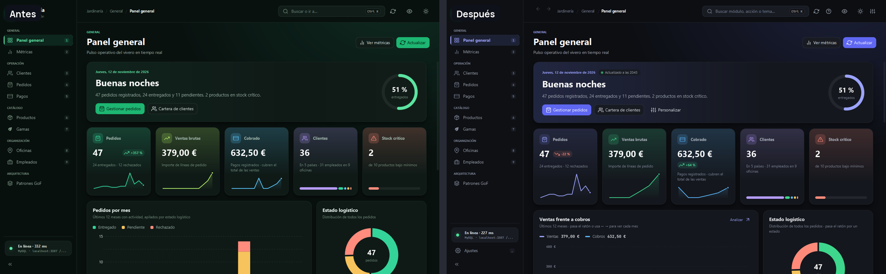
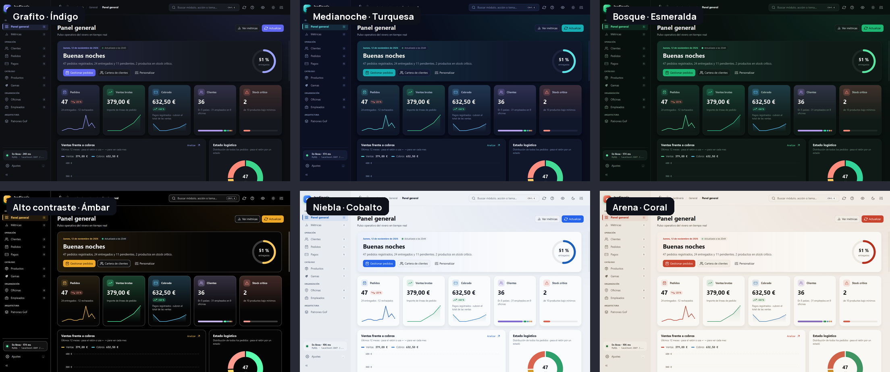
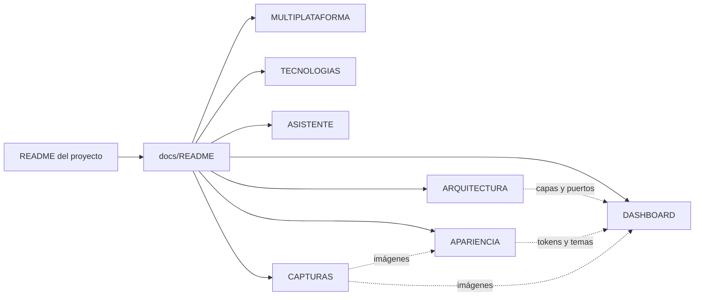

# Documentación

Guía técnica y visual de **Jardinería · Suite de gestión**. Cada documento combina diagramas (Mermaid, que GitHub dibuja automáticamente) con capturas reales de la aplicación generadas por las pruebas.

| Documento | Para qué sirve |
|---|---|
| [MULTIPLATAFORMA.md](MULTIPLATAFORMA.md) | Instalación y ejecución en Windows, macOS y Linux; JAR por plataforma; diferencias y solución de problemas |
| [ARQUITECTURA.md](ARQUITECTURA.md) | Capas hexagonales, flujo de una petición, modelo de datos, hilos y concurrencia, mapa de paquetes |
| [TECNOLOGIAS.md](TECNOLOGIAS.md) | Cada tecnología del proyecto: qué es, por qué se eligió y dónde se usa |
| [DASHBOARD.md](DASHBOARD.md) | Anatomía del panel general: widgets, fuentes de datos, cálculos, interacciones y accesibilidad |
| [APARIENCIA.md](APARIENCIA.md) | Sistema de temas, acentos y perfiles (estilo terminal de Ubuntu), tokens de color y canalización de estilos |
| [ASISTENTE.md](ASISTENTE.md) | Asistente con Groq: configuración, herramientas de solo lectura, recuperación de documentación (BM25) y pruebas |
| [CAPTURAS.md](CAPTURAS.md) | Cómo se generan las imágenes de esta documentación y galería completa |

## Vista rápida

## Mapa de la documentación

