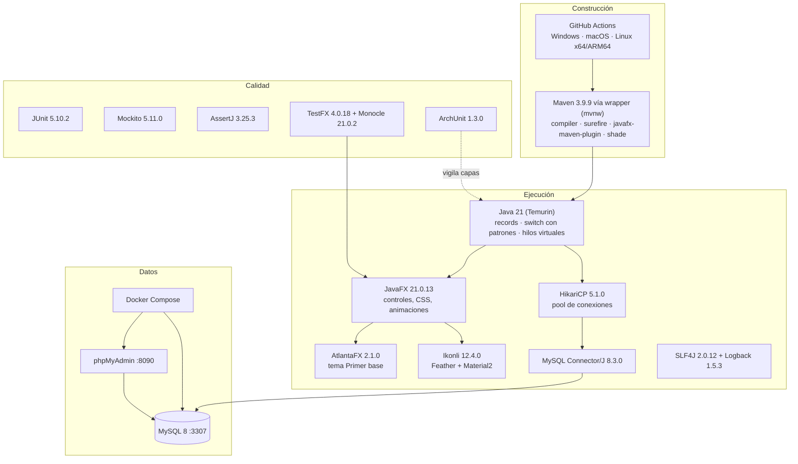
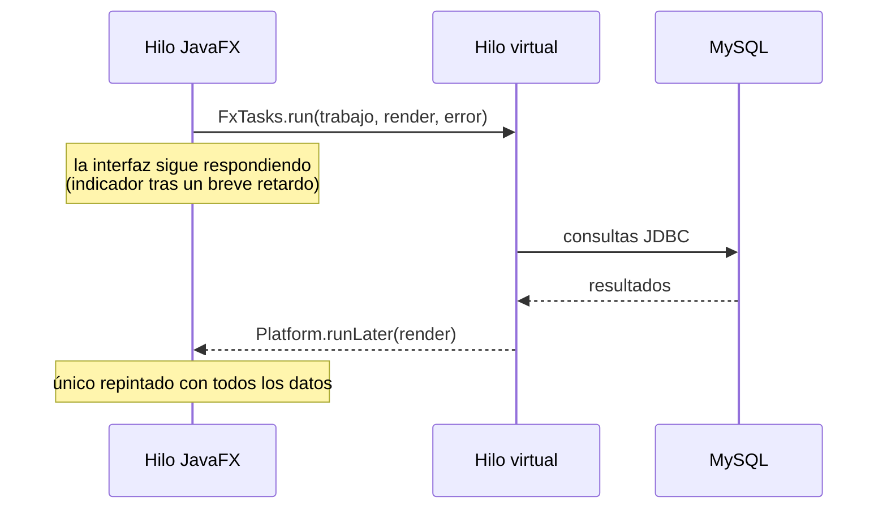
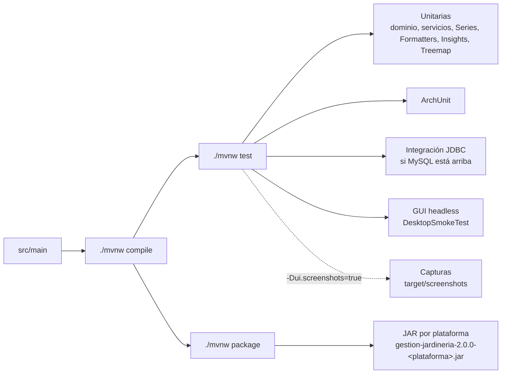

# Tecnologías

Qué se usa, por qué y dónde. Las versiones son las fijadas en `pom.xml` y `docker/docker-compose.yml`.

## 1. Mapa general

## 2. Detalle

| Tecnología | Qué es | Por qué aquí | Dónde |
|---|---|---|---|
| **Java 21** | LTS de Java | Records para DTO e instantáneas inmutables, hilos virtuales para consultas sin congelar la GUI | Todo el proyecto; `FxTasks` |
| **JavaFX 21** | Toolkit de interfaz de escritorio | Gráficos vectoriales, CSS y animaciones nativas sin navegador | `infrastructure.adapter.in.desktop` |
| **AtlantaFX** | Temas modernos para JavaFX | Base Primer sobre la que se superponen los temas propios | `ThemeManager` |
| **Ikonli (Feather, Material2)** | Iconos como fuente | Escalables, coloreables por CSS; sustituyen a los emojis (prohibidos) | `support.Icons` |
| **MySQL 8** | Base de datos relacional | Requisito del proyecto; datos de `jardineria` | `docker/init/01-jardineria.sql` |
| **JDBC + HikariCP** | Acceso a datos + pool | SQL explícito con `PreparedStatement`; conexiones reutilizadas | `adapter.out.persistence.jdbc`, `DatabaseConnectionManager` |
| **Groq** (API compatible con OpenAI) | Modelo de lenguaje del asistente | Respuestas rápidas, modelos abiertos y llamadas a herramientas; la clave va en `GROQ_API_KEY` | `adapter.out.llm.GroqLanguageModelAdapter` |
| **`java.net.http` + Jackson 2.17** | Cliente HTTP y JSON | El cliente HTTP es del JDK; Jackson traduce mensajes y herramientas sin que la capa de aplicación conozca el JSON | `GroqLanguageModelAdapter` |
| **BM25** (propio, Java puro) | Recuperación de documentación (RAG) | Groq no ofrece embeddings; la búsqueda léxica sin tildes basta para un corpus pequeño y no añade dependencias | `application.service.rag.DocumentIndex` |
| **Docker Compose** | Orquestación local | MySQL y phpMyAdmin con un comando, misma configuración en cualquier equipo | `docker/docker-compose.yml` |
| **SLF4J + Logback** | Registro | Trazas de conexión y errores sin `System.out` | Configuración y repositorios |
| **java.util.prefs** | Preferencias del usuario del SO | Persistir perfiles de apariencia sin ficheros sueltos | `theme.ProfileStore` |
| **JUnit 5 + AssertJ** | Pruebas | Aserciones legibles | `src/test` |
| **Mockito** | Dobles de prueba | Servicios sin base de datos | `ApplicationServicesTest` |
| **ArchUnit** | Pruebas de arquitectura | Impide que el dominio dependa de JDBC o JavaFX | `HexagonalArchitectureTest` |
| **TestFX + Monocle** | Pruebas de GUI sin pantalla | Recorre todas las vistas y genera las capturas de esta documentación | `DesktopSmokeTest`, `DesktopScreenshotTest`, `DesktopGalleryTest` |
| **Maven Wrapper** | Script que descarga Maven | Nadie necesita instalar Maven; misma versión en todos los equipos | `mvnw`, `mvnw.cmd`, `.mvn/wrapper` |
| **GitHub Actions** | Integración continua | Compila, prueba y genera el JAR en Windows, macOS y Linux (x64 y ARM64) | `.github/workflows/ci.yml` |
| **Mermaid** | Diagramas como texto | GitHub los dibuja; viven junto al código | `docs/*.md` |

## 3. Concurrencia en la interfaz

## 4. Flujo de construcción y pruebas

